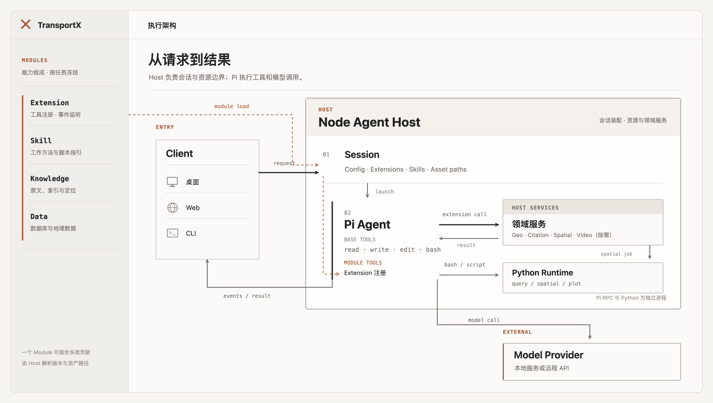
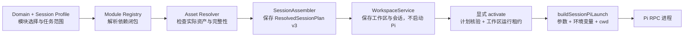
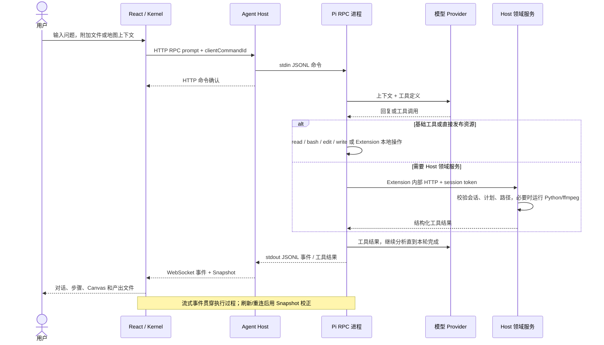
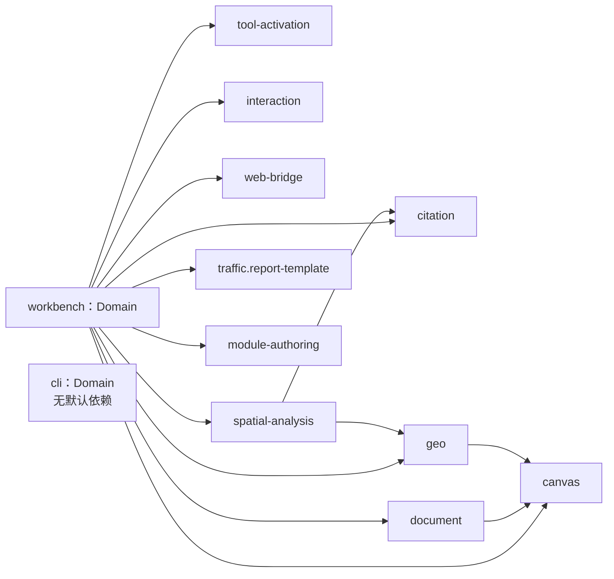

# TransportX Agent 架构

- 源码版本：3.24.0（2026-10-28 已发布 macOS arm64；平台状态见 [发布记录](releases/3.24.0.md)）
- 文档状态：当前实现的架构权威
- 更新日期：2026-10-28
- 发布 Profile：macOS arm64（DMG + ZIP 更新包）与 Windows x64（NSIS）；Linux 不是发布目标

TransportX Agent 是面向交通分析的桌面工作台。Agent 与分析人员共享同一份 GIS 上下文，领域能力按任务装配。项目采用单仓库、单 npm 包和模块化单体架构：Electron 管理桌面生命周期，Node Agent Host 是唯一业务后端，Pi 框架负责模型调用循环与工具执行，Python 执行分析脚本，React 提供图形工作台。CLI 是共用后端的终端客户端。

模型推理由配置的 Provider 提供，可使用远程 API 或本地服务；仓库没有自研模型推理引擎。本文以当前源码、Module manifest 和打包配置为依据，历史方案仅用于了解背景。正式发布状态与源码实现分开记录，见 [CHANGELOG](CHANGELOG.md) 与 [发布记录](releases/3.23.0.md)。

阅读顺序：第 2 节看进程与技术栈，第 3 节看执行闭环与功能位置，第 5 节看模块装配和依赖，第 4、6、7 节看状态与资源边界。

工作区/会话整改正在集成分支实施；下文描述当前源码，完整 A/B 门槛及跨平台交付尚未完成。范围见 [整改 PLAN](<工作区与会话机制整改 PLAN.md>)，验证状态见 [P0 记录](<工作区与会话机制整改 P0 记录.md>)。

## 1. 项目目录速览

```text
pi-tau-traffic/
├─ desktop/                    Electron 主进程、Supervisor、平台 Profile 与打包脚本
│  ├─ assets/                  图标、签名与平台资源
│  └─ scripts/                 runtime 准备、发布前检查、打包钩子
├─ modules/                    随应用发布的能力单元
│  ├─ capabilities/            Canvas、Document、Geo、Citation、Spatial Analysis、Interaction、Web Bridge
│  ├─ official/                Workbench/CLI Domain、报告模板、Module Authoring
│  └─ installable/             本地暂存目录，不入 Git、不随包发布
├─ src/
│  ├─ contracts/               跨层协议与验证原语；不依赖具体运行时
│  ├─ server/                  Node Agent Host、会话、资源、HTTP/RPC 与鉴权
│  ├─ public/                  浏览器 Kernel、共享工具与 Geo runtime 源码
│  └─ web/                     React 工作台、功能面板、组件、i18n 与样式
├─ scripts/                    场景测试、fake Pi harness、eval 与构建辅助
├─ test/                       suites/ 直接注册关键场景；support/ 与固定 fixtures
├─ docs/                       架构、发布说明、变更记录与历史文档
├─ package.json                构建、开发、发布与场景测试入口
└─ tsconfig*.json / vite.config.ts
                              TypeScript 与前端构建配置
```

以下目录由构建生成，不手工编辑或提交：`bin/`、`public/*.js`、`dist/web/`、`dist-desktop/`、`desktop/build/`、`release/`。

## 2. 运行时边界

### 2.1 进程与通信



[可编辑 SVG](./images/architecture-overview-zh-workbench.svg) · [上一版图](./images/architecture-overview-zh-workbench-v1.png) · [原始架构图](./images/architecture-overview-zh.png)

实线表示运行时请求、调用或结果；虚线表示模块装配。图中的 Host 边框表示会话与资源管理边界：Pi RPC 是 Host 启动的独立进程，Python 可由 Pi 工具或 Host 领域服务调用；Module 不是独立服务。当前 Supervisor 在 macOS 使用 `utilityProcess.fork`，Windows 使用 Electron 可执行文件配合 `ELECTRON_RUN_AS_NODE=1` 启动 Node 子进程。CLI 自行启动 Host 子进程；Web 模式直接运行 Host，均使用同一组会话与领域服务。Pi 的基础工具读写任务文件，部分 Extension 直接发布资源或持久化状态；Host 负责对外提供经过校验的文件与资源。文件与资产的具体边界见第 3.4、4、6 节。

图左侧的 Extension、Skill、Knowledge、Data 是 Module 可组合的贡献类型，不是四种互斥的安装包。Pi 默认启用 `read`、`write`、`edit`、`bash` 四个基础工具；Extension 可注册额外工具，Skill 提供工作方法，Knowledge 和 Data 作为会话资产供工具与脚本使用。Pi 维护活动工具集合并发起调用：基础工具和部分 Extension 在 Pi 侧执行，另一些 Extension 调用 Host 领域服务。Host 负责会话装配、资源校验与领域服务，并非所有工具的统一执行器。Python 仅由 `bash` 或 Host 受控作业按需调用。

Workbench 采用 Eager Registration + Lazy Activation：计划内 Extension 初始化时完整注册，新的受管会话首请求只开放上述四工具与 `manage_capabilities`。管理工具以 discover/inspect/status 只读查询，以 enable(moduleId) 开放该模块全部来源和契约核对合格的工具；Module 依赖只影响装配，不传播 active。归属通过 Host 已核验 Plan 的精确入口与 Pi sourceInfo 的 realpath 相等派生，独立包不需进入核心工具表。Pi 仍是唯一 Registry 与 Agent Runtime，enable 不安装模块、不启动业务、不授予执行权限。

`transportx-tool-activation/v1` custom entry 是唯一开放状态恢复记录：assembly 保存初始化成员，enable 保存本分支成功意图；启动、reload、恢复与分支导航从有效分支重建，压缩不依赖模型记忆，不重放业务。成员漂移拒绝启用，需新会话装配；运行中晚注册不支持，已有核对点诊断不兼容，不增加监听器。新安装/更新不改变已有计划；冻结旧计划没有该模块时不注入额外 Extension。Bridge 在开放事件重新采样，inactive 且来源/Schema 合格为待启用，执行和授权仍由原工具/Host 判断。实测及边界见 [验收记录](<Module 工具按需启用验收.md>)。

### 2.2 技术栈分工

| 技术 | 位置与责任 | 实现依据 |
|---|---|---|
| Electron 43 / electron-builder 26 | 主进程、隔离 Renderer、Host 子进程、桌面集成与打包 | [main.ts](../desktop/main.ts)、[Supervisor](../desktop/agent-host-supervisor.ts) |
| Node.js / TypeScript / HTTP / ws | 唯一业务后端；生命周期、命令、事件和资源访问 | [server-main.ts](../src/server/server-main.ts) |
| Pi coding agent 0.80.10 | Agent 执行框架；连接模型 Provider，执行基础工具与扩展，维护会话历史 | [package.json](../package.json)、[session-pi-launch.ts](../src/server/session-pi-launch.ts) |
| React 19 / Vite 8 / Tailwind 4 / Radix Dialog | UI 组件、构建、样式和交互；无独立前端业务服务器 | [src/web](../src/web)、[vite.config.ts](../vite.config.ts) |
| Browser Kernel / TypeScript | 项目自有客户端状态层；事件归一化、分发、stores、命令端口，不依赖 React/DOM | [app-kernel.ts](../src/public/kernel/app-kernel.ts) |
| MapLibre GL 5 | Geo 场景的浏览器渲染与选择交互；空间计算交给 Python | [Geo runtime](../src/public/visualization/geo) |
| Python 3.10 / SQLite / NumPy / Pandas / Matplotlib / PyProj / Shapely | 数据查询、计算和图件生成；SQLite 是模块数据文件格式，不是平台会话数据库 | [python-requirements.txt](../desktop/python-requirements.txt)、[PythonRunner](../src/server/python-runner.ts) |
| ffmpeg / ffprobe | 视频探测、截图、裁剪、抽帧；来自独立 Video Capability 包 | [VideoRunner](../src/server/video-runner.ts)、[打包脚本](../desktop/scripts/package-video-capability.mjs) |

版本对应当前 `package.json` 声明，不表示未来升级约束。

### 2.3 三种启动方式

| 模式 | 启动链 | 地址与配置 |
|---|---|---|
| 桌面 | Electron Main → Supervisor → `bin/tau.js` → Host → Pi | `127.0.0.1` 随机端口；桌面用户目录与包内运行时 |
| Web 开发 | `start.sh` → `bin/tau.js` → Host；可另启 Vite | 脚本默认 `127.0.0.1:3000`；Vite `5173` 代理 API/WS；Pi 配置默认 `~/.pi/agent/` |
| CLI | `bin/transportx.js` → 启动 `bin/tau.js` → HTTP/WS 客户端 | 显式 `127.0.0.1:0`，随机凭据；Pi 配置默认 TransportX 用户目录，可覆盖 |

直接运行 `bin/tau.js` 默认监听 `127.0.0.1:3001`。非回环监听必须显式开启 remote 并配置、启用认证；监听期间不能关闭认证。参见 [config.ts](../src/server/config.ts)、[start.sh](../start.sh)、[transportx.ts](../src/server/transportx.ts)。

### 2.4 Electron Main

`desktop/main.ts` 与 `desktop/agent-host-supervisor.ts` 只承担桌面壳职责：

- 单实例、窗口创建、外链交给系统浏览器、退出时清理 Agent Host 进程树；
- 在加载工作台前等待 Agent Host 的版本化 ready 消息，并校验 `/api/health`；
- 已打包应用启动前验证 `runtime-manifest.json` 中 Agent Host、Pi 与 Python 的路径和 SHA-256；
- 以禁用 JavaScript 且阻断网络的隐藏窗口生成 PDF；
- macOS 保留原生 traffic lights；Windows/Linux 使用无边框窗口和 React 渲染的最小化、最大化、关闭按钮，控件位于左侧并沿用 macOS 顺序。

桌面更新由 `desktop/update-service.ts` 维护，打包应用启动后检查一次，用户也可在设置页检查。发布版本以 `https://transportxlab.com/application/transportx-agent/` 中当前平台、官方 HTTPS 下载域名下的安装包链接为准；版本目录与文件名必须一致，平台命名规则集中在 `platform-profile.mjs`，仅比较正式 SemVer。界面分别显示本机版本和官网最新版本，不把未发布的源码版本当作最新发布版本。

应用内下载安装继续使用包内 `app-update.yml` 指定的 OSS `latest*.yml` 与 electron-updater 的文件校验、平台签名验证和缓存恢复。仅官网版本与可用清单版本一致时提供应用内下载；清单缺失、未公开或版本不同而官网有新版时提示手动下载，无更高版本则显示普通状态。官网连接、清单解析、下载或校验故障仍显示错误。下载与安装须由用户分别触发，安装前由 Host 确认任务空闲、保存与停止；普通退出不安装。正式签名跨版本升级验收与线上清单开放状态见 [3.23.0 发布记录](releases/3.23.0.md)。

Renderer 始终使用 `nodeIntegration: false`、`contextIsolation: true`、`sandbox: true` 和 `webviewTag: false`。Preload 不提供通用 Node/Electron 能力，只暴露：受同源校验的 PDF 下载、上传文件真实路径、固定的更新状态与操作接口，以及非 macOS 的窗口控制。

### 2.5 Agent Host

`src/server/server-main.ts` 是唯一业务组合入口。桌面模式监听随机回环端口，其他入口见上表。它提供：

- HTTP API 与带 `clientCommandId` 的可靠 RPC；
- WebSocket 实时事件与 Snapshot 更新；WebSocket 不接受有副作用命令；
- Session、附件、文件预览、本机打开、Canvas、引用、报告、Geo、空间分析和视频资源；
- 模型配置、认证、Module Registry/Installer、Asset Resolver 与 Session Assembly；
- Pi、Python，以及可安装 Video Capability 提供的 ffmpeg/ffprobe 受控调用。

Electron 不复制上述业务逻辑；命令行/Web 开发模式也复用同一个 Agent Host。

`workspace-host.ts` 与 `workspace-api.ts` 是持久工作区/会话的公开入口。`workspaceId` 标识共享目录，`conversationId` 标识历史、冻结计划和私有状态，Pi 的 `id` 只标识当前运行实例。创建保存记录和计划，不启动 Pi；读取 Snapshot 不要求运行实例。激活先校验目标计划与已知模型是否可用，再经 `ConversationRuntime` 与 `WorkspaceRuntimeGate` 取得排他权；忙碌、压缩、队列或交互不能静默丢弃。实际进程与作业停止、状态提交确认后才释放租约。`workspace-transfer.ts` 只负责会话跨工作区移动：standalone catalog 条目及其独立目录不出现在工作区分组中；Pi 历史保留原 history key，仅重写核验过的 header cwd，冻结计划只改 `workspace`，目标记录先提交、来源后移除，异常中断按 header 归属回收重复记录。

公开接口使用 `/api/workspaces`、`/api/conversations` 与 `/api/migration`；文件、附件和领域资源使用 `/api/conversations/:conversationId/...`。旧 live 列表、路径恢复、按路径删除与通用文件路由已移除。内部 Extension token 通道、RPC 与事件仍携带实际 live ID，Host 复核其持久绑定与当前租约。高级服务无法证明当前计划/资产/发布归属时拒绝读取，不能用共享 cwd 或旧 live ID 授权。

协议版本由 `src/contracts/host-protocol.ts` 统一为 2。客户端业务前校验 Host role、协议和 dataState，写入携带版本头，WebSocket 首条必须为版本化 hello。ready JSON 仅说明地址可用；初始化或数据阻塞仍提供诊断，不触发 Supervisor 重启循环。全局清单、catalog 或墓碑不可信时禁止业务；完成全局清点后，各工作区独立转换、修复、隔离与就绪，不要求所有旧历史先处理完。迁移决策验证请求 ID、报告摘要和管理版本，不自动清空损坏文件。


### 2.6 Pi、Python 与 ffmpeg

开发启动 `npm run desktop:dev` 和 `./start.sh` 会读取项目根目录的可选 `.env.local`，其中可设置 `TAU_PYTHON_COMMAND` 为目标环境的解释器绝对路径；已导出的同名环境变量优先，未配置时仍使用 PATH 中的 `python3`。`.env.local` 不入 Git，可参考 `.env.example`，不修改全局 shell PATH。Host 将选定解释器传给 Pi 的同名变量及会话上下文；脚本、依赖探测和 `-m pip` 应使用同一解释器。正式安装包不读取此开发配置，继续使用内置运行时机制。

每个显式激活的会话以 Pi RPC 进程运行；已保存但未激活的会话不占 Pi 实例。Session Assembly 将本任务精确解析出的模型、Extension、Skill、Prompt、Module Asset 根目录和工作目录传入 Pi。Pi 的历史 Session JSONL 是已完成对话的事实来源。

发布版基础安装包使用随包 Pi 与 Python 3.10，不包含 Video Skill、Video Extension、ffmpeg 或 ffprobe。ffmpeg/ffprobe 只由平台专属的可安装 Video Capability Module 提供。开发模式保留显式运行时覆盖用于测试，不构成发布版依赖。Host 的空间分析作业经 `PythonRunner` 控制工作目录、UTF-8、超时、取消与进程回收。通用数据查询和制图也可以由 Pi 的 `bash` 工具按 Skill 指引调用 Python，这条链路不经过 `PythonRunner`；不能将所有脚本执行描述为 Host 领域服务或操作系统级沙箱。发布版不依赖开发机 Conda 或系统 Python。内置 Python 要求包含 `ssl`、`sqlite3`、PyYAML、NumPy、Matplotlib、Pandas、PyProj、Shapely、ezdxf。

### 2.7 React Workspace 与 Browser Kernel

Canvas 打开后与对话列并排，分隔条可调整对话列宽度；Canvas 顶部的具名标签承载当前任务的地图、视频和文档。`pi-canvas` 1.0 Presentation Envelope 统一 `present / focus / update / clear` 生命周期、受控资源引用、`viewId`、`revision` 与每次呈现意图的 `presentationId`；Projection Core 兼容旧 Geo / Video Tool Result。受信任的 Adapter Registry 负责领域 payload、target、延迟 Renderer 和显式 Context，Canvas Shell 只管理标签与生命周期，不动态加载 Module 提供的前端代码。关闭标签不删除成果；切换标签不重复挂载视图，隐藏视频暂停。

`src/public/` 提供浏览器端的 Kernel、Markdown/工具结果处理和 Geo runtime；`src/web/` 负责 React 应用、功能面板、i18n 与样式。React 通过 Kernel 消费 Snapshot/事件并发送命令，不解析原始 Pi RPC，也不直接访问本机文件。

Pi RPC 事件按当前锁定版本逐项归一化：`agent_settled` 结束运行态，`session_info_changed` 更新原生会话投影；管理名称以 Manifest 为准，显式重命名同时镜像到当前 Native 历史。`queue_update` 按完整数组替换会话的 `piQueue.steering / followUp`，Host 去除内部附件、Geo 与 Canvas 提示后，随实时事件、会话列表和 Snapshot 返回；Session Store 按会话隔离，输入框上方分别展示等待处理的引导与后续消息。消费或清空以 Pi 的空数组/缩短数组为准，保留重复文本，`agent_settled` 不自行清队列；切换、刷新及断线重连通过 Host Snapshot 恢复，并沿现有 revision 机制重放 Snapshot 请求期间的新事件。此队列与浏览器本地待发送队列独立，不写入 localStorage、不触发重发；Pi 进程退出后不重建其内存队列。Extension UI 只有 `select / confirm / input / editor` 等待回答并进入重连 Snapshot；`notify` 展示通知，`set_editor_text` 更新所属会话的输入草稿，两者均不回传回答。`setStatus / setWidget / setTitle` 是终端呈现提示，工作台没有对应终端区域，显式忽略；模型同步的专用 `setStatus` 回执仍由 Host 先消费。未知事件及未知 UI 方法保留协议诊断。CLI 仅对需要回答的 UI 请求要求转到桌面，不因单向通知终止任务。

侧栏按工作区分组并保存折叠，工作区内按实际消息活动排序；无消息显示“尚无对话”并只在排序时回退创建时间；已有消息但没有可信时间则显示“活动时间未知”，不把恢复/编辑时间当作对话时间。标签、草稿和前端缓存使用 conversationId，关闭运行实例保留历史视图，重新激活替换实际 live ID，迟到事件和 Snapshot 必须匹配当前绑定与 Host/请求代次。侧栏固定工具栏下方按能力区 30% / 会话区 70% 分配空间，两区可收起，移动端默认收起能力区。能力中心按技能、数据、知识、工具、模板分类并支持搜索；数据来自 `platform.getOverview()`，由 [capability-projection.ts](../src/web/platform/capabilities/capability-projection.ts) 按具体模块与资产状态投影。模块是否启用、资产是否就绪和本会话是否装配分别呈现。

Light / Dark / Sand 的 primitive 与 semantic token 统一声明在 [tokens.css](../src/web/styles/tokens.css)，组件消费 semantic token。界面支持中英与跟随系统语言；主题、语言、执行详情偏好和按会话保存的输入草稿属于客户端状态。执行详情默认折叠为 Working，展开后读取同一组工具、思考与错误投影；耗时由 Host 的事件计时及任务侧计时索引恢复。

### 2.8 构建时项目接入点

[project-adapter.ts](../src/server/project-adapter.ts) 提供 Host 认证、模型 Provider 配置和额外 Pi Extension 的静态接入点；[project-ui.tsx](../src/web/app/project-ui.tsx) 提供桌面窗口控件、更新入口、原生操作和模块选项默认折叠设置，`App` 另接受账户区域。仓库默认实现使用现有桌面能力，Host 项目认证为空。接入点由产品构建选择，不是会话 Module 或运行时前端插件；额外项目 Extension 在会话计划中的 Extension 之前加入 Pi 启动参数。

模型目录由 Host 持有的单个 Pi `ModelRuntime` 维护，普通读取离线加载 `models-store.json` 与 `models.json`，配置/认证变化时调用 Pi `reloadConfig()`；不另设列表 TTL 缓存。工作台的「刷新模型列表」调用 Pi `refresh({ allowNetwork: true, force: true, signal })`，复用 Pi 的供应商目录、缓存和用户覆盖规则，逐供应商返回失败原因；刷新有 15 秒上限，失败保留已有目录。自定义兼容服务仍经 `discover_local_models` 获取 ID，能力由显式模型配置提供。

运行中的 Pi 子进程继续 `--offline`。刷新当前空闲任务，以及 `set_model` / `cycle_model` 前，Host 先通过原生 `get_commands` 确认 Web Bridge 的 `transportx_reload_models` 已注册，再通过原生 Extension command 调用 `ctx.modelRegistry.refresh()`，只重读本地模型配置与缓存。`setStatus` 回执按随机 token 确认完成并由 Host 消费，不进入对话或调用模型；Pi 对 Extension command 错误仍可能 ACK，因此不能只依赖 prompt ACK。任务忙碌或旧 Bridge 缺失时明确提示，禁止发送未知 slash command；不重启进程、不执行完整 `/reload`，不改变已激活工具或自动切换当前模型。

## 3. 关键数据流

### 3.1 创建与装配



[session-assembly.ts](../src/server/session-assembly.ts) 冻结模块和资产；[session-pi-launch.ts](../src/server/session-pi-launch.ts) 构造进程参数；[conversation-runtime.ts](../src/server/conversation-runtime.ts) 管理持久会话生命周期，[sessions.ts](../src/server/sessions.ts) 管理实际 Pi 实例和作业。

Prompt 按顺序装配：`src/server/prompts/PI_SYSTEM.md` 定义通用基础行为；Host 根据 `desktop/scripts/platform-profile.mjs` 的 `systemPrompt` 映射附加 `PI_SYSTEM_POSIX.md`（macOS / Linux）或 `PI_SYSTEM_WINDOWS.md`（Windows），两份环境规则独立维护，并与基础行为一起传入 Pi 的 `--system-prompt`；所选 Domain 的 `PI_SESSION_CONTEXT.md` 注入任务目录、Python 命令、Skill 与资产清单；CLI 可再追加用户指定的系统提示词文件。Windows 附加规则明确 `bash` 工具仍使用 Bash 语法，禁止 `nul` 重定向及创建 Windows 保留名。Skill 由 Pi 读取作为工作方法，Extension 在 Pi 进程内注册可执行工具或监听事件。

基础行为要求按用户当前使用的语言回答；工作状态、计划、进度、阻塞说明和结论写在普通正文中，思考过程不承担用户沟通。

新任务必须显式选择模型。`ResolvedSessionPlan v3` 记录实际 Module 版本、入口路径、Asset，以及 Native Runtime 的版本、绝对路径和 SHA-256；恢复任务沿用该计划中的模块目录与入口，同一版本的 Skill、Extension 和 Prompt 内容不进行逐字哈希比对，但磁盘 manifest 的 ID 和版本必须与冻结记录相等；缺失或不同版本明确拒绝，不自动替换。新计划不再记录这些内容哈希，旧 v3 计划中的对应字段兼容忽略；模块目录、清单和入口文件缺失仍报错。计划固定选择与路径，不保证可编辑代码的逐字复现。内置模块的代码根目录跟随当前应用位置，同 ID、同版本核验通过后，将入口从旧根相对映射到当前可信内置模块根；安装模块和资产保持原路径与校验规则。Native Runtime 与声明了完整性清单的资产继续执行各自的校验。

界面展示 created、legacy-workspace、confirmed-current 的配置来源与可信度。日常恢复只读取 Manifest 中该会话的独立 plan 路径，不再扫描共享旧计划或运行旧格式迁移。旧 `.tau/resolved-session-plan*.json` 仅由统一工作区迁移器读取；缺失、schemaVersion 2 或无法核验的原计划保留原件并记为 null。用户确认当前配置后，新建独立 v3 plan 并标 `confirmed-current`，不声称还原了原配置。既有冻结计划缺少精确版本时仍保持历史只读，不自动映射退役 Video 或跳过 Timing 条目。Citation 升级属于同一次工作区转换，见第 4.2 节。

模块的用户展示信息由 `manifest.json` 的可选 `presentation` 提供，不改变 `manifestVersion: 2`。`defaultLocale` 指定默认语言，`locales.zh-CN` / `locales.en-US` 分别包含 `name`、`description` 与可选 `features`。`presentation.skills` 按已声明的 Skill 入口路径覆盖，`presentation.assets` 按已声明的资源 ID 覆盖；各覆盖项沿用相同的 `defaultLocale + locales` 结构，不能引用未声明的入口或资源。

Host 将完整展示元数据投影到能力概览、任务模块选项和 ZIP 安装预览，React 统一按界面语言选择文案；缺少当前语言时回退模块默认语言。模块自身的 `presentation` 优先；对尚无该字段的已知旧包，前端按 Module ID 使用 `src/web/lib/legacy-module-presentation.ts` 中的兼容展示文案，覆盖现有六类数据包及知识、绘图、视频模块，用户无需重新安装大体积资产。其他旧模块继续使用原始名称与 Skill 说明。搜索同时匹配两种语言。平台翻译文件只维护分类、状态和操作等界面文字；新模块文案随模块包维护并遵守模块版本纪律，兼容文案不写回旧包或更改模块版本。原始 Module ID/name、Skill frontmatter name/description、工具标识和 Agent 正文不随界面语言改变，也不注入展示翻译作为运行指令。

Prompt、steer、abort 与 Extension UI response 先经 HTTP RPC 确认，再更新前端状态。WebSocket 只用于实时 Pi 事件和 Snapshot；断线或刷新后由 Agent Host Snapshot 重新校正。

关闭只停止运行实例，保留逻辑会话与文件。删除会话和删除整个工作区是两个独立入口：前者保留共享资料与其他会话；后者独立确认固定目录与全部会话集合。`workspace-deletion.ts` 在运行门禁内先停止 Pi 和受管作业，再依次提交 invocation 清理、Native 历史清理、私有状态或目录清理阶段。清理 invocation 时，原 plan、cwd 和 JSONL 必须仍可核验；历史已删并成功提交阶段后，重试不再访问已删依赖。

目录删除保存 catalog 墓碑、history key 集合与 dev/ino/birthtime 身份；目录部分移除后从 catalog 续跑，不重建 Owner 或重新发现删除目标。未知归属、根符号链接、嵌套/其他登记目录、未记录的 cwd 进程和目录被替换均拒绝清理。最终提交和停止状态未确认时保留目录外的运行代次，不允许另一实例接管。文件路径边界统一使用 `isWithin`/`path.relative`，磁盘路径以 POSIX 保存。

### 3.2 一轮分析的执行闭环



这里有两种不同的 RPC：客户端到 Host 是 HTTP RPC，Host 到 Pi 是标准输入/输出上的逐行 JSON。扩展调用 Host 的内部 HTTP 是工具服务通道，使用按会话、按服务发放的 token；参见 [pi-rpc-transport.ts](../src/server/pi-rpc-transport.ts)、[session-service.ts](../src/server/session-service.ts)。

### 3.3 功能如何跨层协作

下表中的服务均位于 `src/server/`；UI 面板均属于同一 React 工作台。

| 用户功能 | Agent / Module 侧 | Host 与持久化 | 展示或交互位置 |
|---|---|---|---|
| 对话、模型、历史恢复 | Pi 基础循环，Web Bridge 发布模型/工具清单 | `sessions.ts`、`session-projection.ts`、`pi-model-config.ts`；`local-model-service.ts` 探测兼容服务 | `platform/conversation/`、`platform/model/`，Kernel stores |
| 用户交互与提问 | Interaction Extension：`tau_ask_user` | Pi Extension UI 请求与工具结果 | `platform/extension-ui/` |
| 交通数据查询与统计制图 | 数据/绘图 Module 的 Skill + Pi 基础工具执行 Python/SQL | 冻结资产根目录；分析输出写入任务 cwd | 对话工具卡、`platform/workspace/` 文件预览 |
| 地图发布与显示 | Geo：`publish_geodata`、`present_visualization`（含 `show_map` 操作） | Extension 写资源 manifest；`geo-resources.ts` 校验并提供 GeoJSON | `features/geo/GeoWorkspace.tsx` + `src/public/visualization/geo/` |
| 空间分析 | Spatial Analysis Extension：buffer / nearest / spatial_join | `spatial-analysis-service.ts` → `PythonRunner` → 模块脚本，生成 GeoJSON + manifest | 结果经 Geo 发布后进入地图 |
| 地图选取与截图 | Geo：`inspect_map_context`、`request_geo_input`、`capture_geo_screenshot` | `geo-interaction-service.ts` 维护上下文与等待请求 | GeoWorkspace 收集选择、渲染并上传 PNG；结果返回 Agent |
| 视频检索与处理 | 可安装 Video Extension：search / present / snapshot / clip / sample_frames | `video-service.ts` → 会话冻结的 `VideoRunner`；资源与预计算指标接口 | `features/video/VideoWorkspace.tsx`，Canvas 视频标签 |
| 知识检索与引用 | Knowledge Module 的 Skill/脚本检索；Citation Extension 注册和解析证据 | `citation-service.ts`、`citation-registry.ts`、`citation-resources.ts` | `platform/conversation/` 引用标记与原文定位 |
| 共享 Canvas | Canvas Extension：`canvas_present`、`canvas_inspect_context`；Document 声明受信任 Adapter | `canvas-service.ts` 校验装配、资源、target 与显式上下文；呈现事件保存在工具结果 | `platform/canvas/` 的状态投影、Adapter/Renderer Registry 与标签容器 |
| 报告、表格、PDF 与 OOXML | 报告 Template + Agent 写 Markdown，引用分析文件/图件 | 文件 API、Citation SHA-256 资源路由、`report-pdf.ts`；桌面请求交给 Electron PDF 渲染 | Canvas `DocumentWorkspace.tsx` 浏览 Markdown/CSV/PDF；`features/office/OfficeWorkspace.tsx` 按格式加载本地只读 DOCX/XLSX/PPTX Viewer |
| 能力安装与任务选择 | Module manifest 声明能力、依赖与资产 | Registry / Installer / Assembler、`platform-overview.ts` | Settings、NewSessionDialog、`platform/capabilities/` |

内置模块不再提供步骤规划器；`tau_ask_user` 只负责在缺少必要信息或审批时向用户发起结构化提问。Task 模块、旧 Task Snapshot 协议及其专用历史兼容已移除，不再提供 `tau_task`、`/task` 或任务面板。Web Bridge 是 Pi 的模型/工具元数据桥，不是网页搜索或浏览器自动化服务。报告不是独立 Agent 或服务流水线：Agent 将数据、空间、视频与知识工具的结果组织成文件。

### 3.4 文件、Canvas、地图与视频

Canvas 是共享视图底层，不等同于 Document，也不承接领域计算。它定义视图身份、`present/focus/update/clear`、revision、受控资源引用及用户显式附加的上下文；现有 Shell、Projection、Adapter/Renderer Registry 共用这些契约。Document、Geo 和已有 Video Adapter 位于其上：Document 包括 Markdown、PDF、CSV 和 Office，Geo 维护地图场景及交互，Video 维护视频资源与播放。Markdown 是 Document 的格式，不单独增加 Module 或 Runtime。CAD 通过平台审核的 Adapter、资源/target 校验和懒加载 Renderer 接入；Module 不允许任意注入前端代码。

本轮迁移 Canvas 两个工具、Geo 五个工具及 Pi-local Interaction 的接口：单一 TypeBox 来源生成各工具包内契约，按工具核对装配、实时 Pi 观察、Schema 与有效领域结果。Canvas/Geo Host 请求复用薄客户端、调用关联、超时及取消；Geo 场景状态、资源发布与 JSONL 恢复仍由原 Pi Extension 负责。Document 无独立执行工具，通过 Canvas 的两个工具完成呈现和上下文读取。Task 模块及其专用历史兼容均已删除。Video 的独立工具迁移后置，保留其现有 Canvas 适配及历史读取。

- 文档既可由用户通过 WorkspaceDock、成果或引用入口打开，也可由 Agent 通过 `canvas_present` 呈现并定位。Agent 呈现事件写入 Session JSONL，可随会话重放；用户手动标签、活动标签和连续滚动状态留在前端。MD/CSV/PDF/DOCX/XLSX/PPTX 的既有入口继续调用 `OpenDocumentContext`；CSV 使用只读表格渲染，不加载 OOXML runtime。
- `canvas_present` 通过 Host 新建资源视图时接受 Document 与 CAD Adapter；文档资源可为任务文件或 Citation SourceVersion，CAD 只接受当前会话 DXF。地图与视频由各自工具发布 Canvas Envelope。操作已有 `viewId` 时沿用已声明 Adapter 和前次资源。只有文档 `update` 由呈现层递增 revision；CAD/Geo/Video 的内容 revision 由领域维护。文档更新时，即使文件 mtime 不变或回退，React 文档与 OOXML Viewer 也会重载，PDF.js 文档实例同步重建；`focus` 保留原 revision，仅表达聚焦与导航意图。
- 用户只有执行“附加当前 Canvas”时才生成 `CanvasContextV1`。Host 在创建时核对当前呈现的 View revision，并保存资源句柄、定位与选区，把 Context ID 附到下一轮用户消息；Agent 必须调用 `canvas_inspect_context` 读取本轮 ID，不能回退读取历史选区。Context 记录视图上下文，不为普通任务文件保存内容快照；连续滚动、播放和鼠标事件不进入会话。
- Markdown 文档复用共享渲染器，由 `report-renderer.ts` 补充公式、Mermaid、图片和标题目录；文档定位在自己的容器内完成，不改变聊天 Markdown。PDF 通过受控 URL 交给本地打包的 PDF.js，在 Canvas 中按可见页面渲染，保留可选择的文字层与链接，不启用 PDF 脚本执行。外围背景和工具栏消费工作台主题 token，提供物理页码跳转、缩放与适应宽度；引用定位使用物理页码，同会话标签切换与刷新恢复当前页码和缩放，新的导航请求优先于保存的位置。worker 由 Vite 打包，CMap、标准字体、ICC 和 WASM 由 `copy-pdf-runtime.mjs` 复制为本地静态资源，不依赖 CDN；`.mjs` 静态文件以 JavaScript MIME 返回。
- DOCX、XLSX 和 PPTX 由 `@silurus/ooxml` 在浏览器内通过 Rust/WASM 解析、Canvas 2D 只读渲染。`features/office/office-resource.ts` 在 GET 前用 HEAD 校验状态和 32 MiB 压缩文件上限；`office-viewer.ts` 按格式动态导入 Viewer，禁用在线字体与超链接并限制解压和图片内存。普通启动、Markdown 和 PDF 路径不加载 OOXML chunk、Worker 或 WASM。
- 普通文件以会话与规范路径识别；引用文档以会话与固定 sourceVersionId 识别，并通过 Citation capability 句柄供用户和 Agent 复用同一标签。引用 URL 携带预期哈希，Host 同时检查注册版本与磁盘内容；原件变化或视图版本不匹配时返回 409，缺失与越权分别返回 404 / 403。手动刷新重新读取内容；关闭标签和切换会话后的迟到结果不会替换当前阅读内容。失效引用的处理见第 3.5 节。
- 附件先上传到任务工作区，再以 `attachmentIds` 关联后续消息；服务端再次校验归属、状态、真实路径和文件存在性后才向 Pi 提供上下文。
- File、Preview、Geo 和 Spatial Analysis 以活动 Session cwd 为边界。Citation/Video 还可读取会话计划中明确解析的 Knowledge/Data 资产根目录，并将派生资源发布到当前任务。模块资产不必复制进 cwd；边界校验不能简化成“只允许读取 cwd”。
- 用户可从地图提交要素、点位、矩形或当前视野四类 Geo Context，并显式附到下一轮消息。Agent 通过 `inspect_map_context` 读取本轮上下文，也可用 `request_geo_input` 等待用户在指定地图 revision 上补充输入；提交、取消、超时、中止和地图失效都有明确终态。
- 地图截图由工作台按当前画面、图例和说明生成 PNG，再写入当前任务目录。截图不扩大资源访问范围。
- Spatial Analysis 只处理当前会话的 GeoJSON，使用受控 Python 生成 WGS84 GeoJSON 与包含输入、参数、计数和哈希的 manifest，再发布到 Geo 界面。
- Spatial Extension 1.2.0 将 Pi `toolCallId` 与 AbortSignal 传给原 Host 路由（调用 ID 不授予权限）；130 秒客户端时限覆盖既有 120 秒 Python 时限。Host 保留最终语义/资源校验，输入拒绝不创建成果目录，正常响应关闭不触发取消。结果校验后原子写入 manifest，可选 Citation 失败继续返回 warning。客户端不重试；丢响应、协议无法确认或未确认取消返回 `spatial_result_unknown`，Pi `tool_result` 将其标记为错误，保留已有成功结果的 `tau-spatial-analysis` 格式。工作台显示“结果未知”，本轮有未确认分析时不提供整轮准备重试；已确认取消单独显示。尚无持久 Invocation 查询或跨 Host 重启的重复保护，需核验任务内已有 manifest/文件，不能据没有 HTTP 响应推断未提交。
- Video 资源与指标由 Agent Host 使用当前会话冻结的 Video Capability ffmpeg/ffprobe 处理；发布版不得依赖系统 `PATH`。

### 3.5 引用登记、交付成果与版本读取

Citation 运行时只接受 `pi-citation` 3.0，在任务 `.tau/citations.json`（schemaVersion 2）保存 SourceVersion 与 Evidence。SourceVersion 固定来源身份、SHA-256、大小与可选书目信息；Evidence 固定对应版本、类型化 locator 与内容性质（原文摘录、知识归纳、数据结果或出处）。正文 `[[cite:evidenceId1,evidenceId2]]` 决定引用的使用位置；不再调用 `tau_cite`，不持久化 Occurrence、来源图或独立书目实体。旧注册表由第 4.2 节的迁移入口转换，运行时解析器不直接兼容旧 Envelope。

`tau_resolve_citation` 有两种互斥输入，均返回本次登记的元数据与 Evidence ID，不返回累计注册表：

| 输入 | 来源与处理 | 边界 |
|---|---|---|
| `sources` | 任务内的已有原件/结果文件，或 `assetId` 指定的已装配 Knowledge/Data 资产文件；Host 定位并计算哈希 | 每次 1–20 项，必须提供具体文件及 locator；`path` 为相对路径，不能填网址或目录 |
| `webUrls` | Host 获取公共 HTTPS 文本页，按 URL 与内容哈希保存到 `.tau/citation-snapshots/`，登记为出处 | 每次 1–10 项；DNS 公网地址校验后固定连接地址，拒绝私网、非 2xx 响应和非 `text/*` 内容，不自动跟随重定向；单页最多 2 MiB |

一次调用只能提供其中一个字段，另一字段须省略；同时引用文件与网页时分两次登记，再复用两次返回的 ID。`sources` 的原文摘录要求文本能在固定位置核对；知识归纳可以关联多个原件，但不能把归纳冒充原文。`metadata` / `querySummary` 是说明，不能证明分析已执行。

Knowledge/Data Module 自行提供目录概览、有限候选与原件/结果读取入口，启动不载入全量正文或记录；目录命中不能直接登记为证据。Citation 不扫描固定知识布局，不建立 Catalog/Provider 框架。小型内联结果只由受控 Host 生产者登记；空间分析成功后，Host 复用 manifest 与输入/输出校验登记计数依据，登记失败单独返回警告并保留成功输出，重试登记幂等。Canvas Context 不转成 Evidence。

Kernel 通过分页列表和按 Evidence ID 查询详情。列表包含来源元数据与 Evidence，不返回内联原始值；内联值仅在有界详情中返回。引用区默认折叠，正文、候选和管理器共用详情；CSV/规则 JSON 的有界表格支持定位行，Markdown/PDF 与书目导出保留同一来源版本的全部具体位置。`sources[].deliverable` 仅标记用户要求的最终文件，Host 返回 `deliverableEvidenceIds`，前端从工具结果和正文引用投影交付成果卡片；没有独立的成果文件扫描或成果注册表。

读取引用原件时，Host 检查当前会话授权、注册哈希与文件大小。错误通过 JSON 的 `code` 与 `X-Citation-Error` 传递：`content-changed`、`view-mismatch`、`missing`、`forbidden`、`unsupported`、`read-failed`。详情在原件不可读时仍返回已登记的来源与定位，并停用失效原件的下载。原件变化后，任务内的文档可经普通文件 API 再次校验后，供用户主动选择打开“当前文件”；该入口明确标注当前文件不是引用版本，不自动替换引用、不改写历史 ID。资产原件不借此扩大为普通文件访问。

本地文件引用保存元数据和哈希，不保存历史文件副本；网页登记单独保存抓取快照。容量上限为内联内容 256 KiB、Registry 8 MiB、文本/表格预览原始读取 2 MiB、最多显示 200 行；文件哈希分块读取。实现依据：[citation-service.ts](../src/server/citation-service.ts)、[citation-registry.ts](../src/server/citation-registry.ts)、[citation-resources.ts](../src/server/citation-resources.ts)、[citation-projection.ts](../src/web/features/citation/citation-projection.ts)。

## 4. 契约与事实来源

| 内容 | 权威来源 | 主要消费者 |
|---|---|---|
| Session、Geo、Citation、附件等跨层协议 | `src/contracts/` | Extension、Server、Kernel、React |
| 已完成的对话历史 | Pi Session JSONL | Session Projection、历史 API |
| 实时会话状态 | Agent Host live overlay | WebSocket、Browser Kernel |
| 任务装配结果 | `<task>/.tau/resolved-session-plan*.json` | Session 恢复、审计 |
| 附件索引 | `<task>/.tau/attachments.json` | Attachment API、会话投影 |
| 引用版本与依据 | `<task>/.tau/citations.json`，由 `citationRegistryId` 绑定其持久 sessionId | Citation Service、资源路由、引用与成果投影 |
| Geo/Video 资源与网页引用快照 | 任务 cwd 下的受控资源目录 | 对应资源 API 与 React 面板 |
| Canvas 呈现与显式上下文 | 呈现为 Session JSONL 工具结果；上下文为 `<task>/.tau/canvas-contexts.json` | Canvas 投影、当前轮上下文读取 |
| 执行耗时 | `<task>/.tau/timing-metrics.v1.json` 与 Host 实时计时 | 会话投影、Working 与工具详情 |
| 地图交互上下文与等待请求 | Session Snapshot、Geo Interaction Service | Pi Geo 工具、Browser Kernel、React Geo Workspace |
| 模型定义与密钥 | 用户目录 `models.json`、`auth.json` | Agent Host、Pi；密钥不返回前端 |
| Module 声明与完整性 | Module `manifest.json`、`integrityFile` | Registry、Installer、Session Assembly |
| Module Native Runtime | Module `manifest.json` 中的 `nativeRuntimes` | Installer、Session Assembly、Video Service |
| 基础打包运行时 | `runtime-manifest.json` | Electron Supervisor、Runtime Resolver |

`src/contracts/` 必须保持纯粹：不依赖 Node、Electron、React、DOM 或 MapLibre。任何跨层字段先定义契约和解析规则，再实现服务端、Kernel、UI 适配。

磁盘、JSON 和跨平台协议中的相对路径一律采用 POSIX `/`；路径边界在 Node 中通过 `path.relative` 和统一的 `isWithin` 判定，不使用字符串前缀比较。

### 4.1 消息、恢复与持久边界

- 附件、Geo、Canvas 随 PendingMessage 交付；拒绝 ACK 按命令身份移除，Pi 用户消息按完整富化文本匹配。Pi 0.80.10 的消息事件不携带 RPC ID；外部 input transform 不属于已验证的关联保证。
- 可靠命令的 pending/unknown 记录不会因 TTL 淘汰。完成记录保留 10 分钟或 200 条容量范围，Host 重启不保证去重；未知结果禁止自动重发，不提供无条件 exactly-once。
- Snapshot 表示当前分支及 live overlay。每次 Host 启动生成 UUID，WS 事件递增 revision；客户端以请求代次和连接代次拒绝迟到结果，回放快照读取期间更新的事件。缓冲超限拒绝快照并安排后续校正。
- activate、close、迁移和删除共用工作区运行门禁，短元数据 Writer 租约只覆盖读改写提交；静态校验、信任和 RPC 握手期间取消不会在迟到结果后启动 Pi。删除必须等待 Writer 和受管作业停止，停止失败保留文件。Host 最多 32 个运行实例、4 个受管作业/分析进程，每会话最多 2 作业；这些限制不覆盖 Pi bash 自行启动的全部进程。
- 同一 Agent 目录只允许一个 Host；正常退出通过 IPC 释放租约，异常退出后仅在确认 owner PID 已退出时自动回收。owner 文件按 nonce 分代，回收者只能删除已检查的那一代；兼容旧 owner.json，缺失、损坏或进程状态无法确认时拒绝接管；settings/models/附件索引损坏拒绝覆盖并保全证据。资源策略、恢复步骤与兼容范围见 [整改 ADR](ADR-架构整改边界.md)。

### 4.2 历史引用迁移与会话恢复

`WorkspaceMigration` 仅自动发现软件默认/显式配置根目录内的工作区，Native header.cwd 只用于关联范围内的历史，不能把其他 Pi 项目登记进来。软件内主动创建的自定义父目录工作区仍按 catalog 管理；旧版本误收录的外部来源退出活动清单，元数据归入 `migrations/workspace-v1/excluded-sources.json`，原文件及 catalog 的身份/删除保护保留。`WorkspaceMigrationRunner` 在目标维护租约内调用 `workspace-migration-plan.ts` 与只读的 [citation-migration.ts](../src/server/citation-migration.ts) 转换器。HTTP 地址就绪后仍可显示全局 initializing/blocked；全局索引可靠时，异常工作区独立阻塞，不影响其他 ready 工作区。

Citation 2.0 / Registry schemaVersion 1 转为 3.0 / schemaVersion 2，保留 registry 身份、来源哈希、书目信息和定位；旧 occurrenceId 作为 evidenceId，未使用的 locator 保留为 Evidence，旧 quote 按 summary 转换，不提升为已核对摘录。V2 缺少文件大小时从现存文件补齐；缺失时以 0 占位并记录诊断，不替换历史哈希。

工作区报告列明实际改写元数据、源/目标摘要、备份和阶段。原始注册表按原字节备份到 `<workspace>/.tau/migrations/workspace-v1/backups/.tau/citations.json`，保留 provenance；不备份原始业务文件或视频，不改写 Native JSONL。源变化、备份/暂存损坏或空间不足时拒绝继续，并从已提交阶段修复或重新准备；无关工作区的新增记录不回滚。

迁移只从 `/api/migration` 与工作区诊断入口进行。旧批量 Citation 写入器、启动/恢复补迁移分支和独立 `migrate-citations-v3.mjs --apply` 已移除，不提供绕过工作区门禁的第二条转换路径。

历史 Markdown 中已知的本机旧 `file/raw`、`file/preview` 地址，仅在包含可核验的绝对路径、经当前 conversation 的真实目录与普通文件边界检查后，投影到新文件 API。新地址不包含旧 live ID 或鉴权参数；每次读取仍检查边界。相对旧路径、其他工作区、私有元数据和无法证明的高级资源保持不可用。只改变展示投影，Native 原字节不变。
## 5. Module 与资产模型

### 5.1 名词与位置

Module 是统一安装与版本冻结单元，manifest 的 `type` 分为 `domain`、`capability`、`module`。这些类型表示装配角色；目录名 `official`、`capabilities`、`installable` 表示源码组织与交付方式，不能用目录名代替类型判断。

| 概念 | 实际含义 | 消费方式 |
|---|---|---|
| Domain | 一次会话的基础配置，贡献恰好一个会话 Prompt，并声明基础依赖 | SessionAssembler 选择 Workbench 或 CLI Domain |
| Capability | 通用能力模块，如 Canvas、Geo、Video | 被 Domain 或业务 Module 依赖，或由用户显式选择 |
| 业务 Module（`type: module`） | 特定数据、知识、样式或模板的组合 | 按任务需要选择；可依赖 Capability |
| Skill | `SKILL.md` 工作方法，可附参考文件和脚本 | `entrypoints.skills` → Pi `--skill`；本身不是可执行工具 |
| Extension | TypeScript/JavaScript 扩展，在 Pi 进程中注册工具或监听事件 | `entrypoints.piExtensions` → Pi `--extension` |
| Data / Knowledge / Template | 数据库、知识原文/索引、报告模板等文件资产 | `contributes.assets` → Asset Resolver → 会话计划和 Prompt |
| Native Runtime | 平台与架构专属可执行文件；当前实现为 ffmpeg/ffprobe 组合 | `contributes.nativeRuntimes` → 安装/装配校验 → Video Service |
| Canvas View | Module 声明使用的平台内置受信任 Adapter；不包含前端代码 | `contributes.canvasViews` → Resolved Session Plan → Canvas Host 校验与 Adapter Registry |
| Session Profile | 用户对任务范围与模块版本的选择 | 装配输入；不是执行进程 |
| ResolvedSessionPlan v3 | 已解析的 Domain、模块版本、入口、资产与运行时清单 | 保存到任务 `.tau/`；用于启动、恢复和完整性校验 |

### 5.2 当前模块依赖图

普通模块的安装、启用及每次 Pi 启动均经过 `ModuleTrustStore`：Host 经私有父进程 IPC 请求 Electron 原生确认，保存具体包规范目录、ID、版本、入口和依赖的接受记录。RPC 的 `trusted:true`、Module 的 `origin` 或熟悉的内置 ID 不授予信任。随应用发布的内置包按平台配置的实际目录识别例外；会话计划中的入口还须由当前包声明。首次运行旧包或非 UI 注入包也必须核对；没有桌面确认通道且没有既有接受记录时拒绝加载。

用户接受该版本按本机权限运行，包含包内编辑；这不锁定全部代码哈希，也不提供 OS 沙箱。新增入口、依赖、版本或更换目录须重新确认，卸载撤销对应记录。拒绝安装/升级仅清理本次复制的版本，保留旧版本。Pi 使用 `--offline --no-extensions --no-skills --no-prompt-templates --no-themes --no-approve`，由受控计划显式加载入口，禁止通过全局/项目自动发现或 reload 绕过确认。Pi 0.80.10 在 offline 模式仍可能为全局 npm 路径查询执行自定义 `npmCommand`，因此安装依赖和 server 构建会运行版本固定的 `patch-pi-resource-discovery.mjs`：四类自动资源均禁用时，两个加载入口直接跳过包发现，只解析显式资源。源码不匹配则构建失败；升级 Pi 必须重新审计。此补丁不改变 Registry、Agent Loop、RPC 或工具调度，模型请求仍可联网；适用于受控发行/开发依赖，不将任意外部 Pi 命令视为等价实现。

箭头统一表示 **“依赖”**，按仓库 `manifest.json` 绘制；图中使用模块短名，完整 ID 通常为 `com.transportx.<短名>`，报告模板为 `com.transportx.traffic.report-template`。

**内置依赖：**



Workbench 默认装配上述十个直接依赖；CLI Domain 无依赖，使用 `--module` 才会增加可选模块及其依赖。Video 不在 Workbench 的默认依赖中。可安装数据、知识或样式包可按其 manifest 依赖 Video、Geo、Citation 等模块；这些包不属于内置依赖图，实际可用包由用户安装目录及启用状态决定。

模块“已安装”“已启用”“被本任务选择”“实际工具已注册”是不同状态，能力展示应消费服务端投影，不能仅凭源码目录存在判断可用。

### 5.3 模块清单与交付

| 源码位置（相对 `modules/`） | 内容 | 装配与交付 |
|---|---|---|
| `official/workbench`、`official/cli` | 两种 Domain 的会话 Prompt | 随包注册，按入口选择一个 Domain |
| `capabilities/interaction`、`citation`、`web-bridge` | 用户提问、引用工具、Pi 元数据桥接 Extension | Workbench 基础依赖 |
| `capabilities/tool-activation` | Module→Tool 来源核对、四动作和分支开放记录 | Workbench 基础依赖；只控制 Pi active |
| `capabilities/canvas`、`document` | 共享画布工具与 Skill、文档 Adapter 声明与使用 Skill | Workbench 基础依赖；Document 依赖 Canvas |
| `capabilities/geo`、`spatial-analysis` | 地图和空间分析 Skill/Extension；空间计算 Python 脚本 | Workbench 基础依赖；Geo 依赖 Canvas，Spatial Analysis 依赖 Geo + Citation |
| `official/traffic-report`、`official/module-authoring` | 报告模板资产、模块编写 Skill | Workbench 基础依赖 |
| `capabilities/cad` | DXF 协作工具、按需 Skill 与受控 Python 引擎 | 官方可选 Capability，依赖 Canvas，默认不选择 |
| 用户安装包 | Video、交通数据、知识库、图表风格、演示数据等可选能力 | 由设置页安装到用户目录，按 manifest 依赖装配 |

配置与路径读取位于 config；Registry、Installer、AssetResolver 与 Assembler 的实例装配位于 [platform-composition.ts](../src/server/platform-composition.ts)。server-main 是组合根，向 Manager 注入已有装配器、工作区创建、启动函数、spawn 与服务 endpoint；sessions 不再在 import 时创建全局 Manager。内置注册以 [config.ts](../src/server/config.ts) 的 `BUILTIN_MODULE_MANIFESTS` 为准。用户安装后位于 `<user-data>/modules/<id>/<version>/`。仓库中的 `modules/installable/` 仅作为本地用户模块暂存目录，默认被 Git 忽略，不属于平台源码；`TAU_MODULE_MANIFESTS` 另提供开发用 external 来源，不等于用户已安装包。

当前配置注册 13 个内置模块（两个 Domain、十个 Workbench 直接依赖与一个可选 CAD Capability）。Task 的 manifest、Extension、历史协议和能力握手字段均已删除；旧 Task 模块不再随源码及新安装包提供。

### 5.4 从包到会话

```text
目录或 ZIP → ModuleInstaller 校验并复制 → 受管模块目录
  → 设置启用 → 新任务选择 Session Profile
  → Registry 按 Domain + 选择项解析依赖闭包
  → Asset Resolver 解析实际资产 → SessionAssembler 冻结计划
  → Pi 加载 Skill / Extension；Host 按计划提供资产与原生运行时
```

平台核心不依赖用户 Module；数据模块可以声明对 Video、Geo 或 Citation 等能力模块的依赖，Session Assembly 会解析并冻结依赖闭包。Data/Knowledge 的大体积资产、原始资料、索引和精确定位映射不进入 Git 或桌面安装包；解析后通过会话资产映射提供给 Pi/脚本。Data 与 Knowledge 分别使用 `TRANSPORTX_DATA_ASSETS_JSON`、`TRANSPORTX_KNOWLEDGE_ASSETS_JSON` 映射资产 ID 到实际目录；Template 路径由会话 Prompt 的资产清单提供。Knowledge 检索由对应模块的 Skill/脚本实现，Citation 服务负责引用证据管理，并非统一的知识检索引擎。

安装器拒绝符号链接、绝对入口、路径逃逸、重复 ID 和缺少入口；带 `integrityFile` 的资产在安装及解析阶段验证 SHA-256。Native Runtime 还必须匹配当前平台和架构，声明的可执行文件路径、哈希和许可证说明都位于模块包内。模块显式启用后只影响新任务；活动任务正在使用模块时禁止卸载。Module 改动必须同步提升其 `manifest.json` 版本并记录 CHANGELOG。

## 6. 目录与持久化

### 用户数据

| 平台 | 默认根目录 |
|---|---|
| macOS | `~/.transportx/traffic-agent/` |
| Windows | `%APPDATA%\TransportX\traffic-agent\` |
| 非发布 Linux 开发模式 | `$XDG_CONFIG_HOME/transportx-traffic-agent` 或 `~/.config/transportx-traffic-agent` |

```text
<user-data>/
├─ scenario/<workspace>/        共享业务目录
├─ workspaces.json              工作区 catalog、创建预留与删除墓碑
├─ sessions/                    Pi Session JSONL
├─ modules/<id>/<version>/      受管 Module
├─ migrations/workspace-v1/     全局清单、源观察报告与阶段
├─ settings.json                Pi 设置与 tau 平台配置
├─ settings/                    预留设置目录
├─ logs/                        Agent Host 等日志
├─ cache/                       Python/Matplotlib 等可清理缓存
├─ models.json                  模型定义
├─ models-store.json            Pi 模型目录缓存
└─ auth.json                    模型密钥
```

以上为桌面布局；CLI 默认共用根目录。Web 开发的 Pi 配置与历史默认在 `~/.pi/agent/` 下，任务工作区默认使用当前平台的 `<user-data>/scenario/`，可分别由 `PI_CODING_AGENT_DIR` / `PI_CODING_AGENT_SESSION_DIR` 与 `TAU_PROJECTS_DIR` 覆盖。`TAU_USER_DATA_DIR` 只用于开发或受控部署覆盖。安装包资源始终只读；升级和卸载不应删除用户数据。同一工作区的业务文件、附件原件和引用注册表共享；冻结计划、消息关联及交互状态按会话隔离。不同工作区不直接共享资源。运行门禁位于平台 home 解析出的固定用户级 `runtime-guards/`，不受 user-data/agent-dir 环境覆盖影响，删除工作区后仍可核验运行代次。

任务侧文件按功能创建，不要求每个任务都具备全部目录：

```text
<task>/
├─ attachments/<id>/           用户上传的文件
├─ 报告、图件、分析结果等        Agent / 受控服务生成的任务文件
└─ .tau/
   ├─ workspace.json            身份、管理/默认版本、会话及删除阶段
   ├─ workspace-owner.json      受管目录创建归属证明
   ├─ conversations/<conversationId>/
   │  ├─ plan.json              本会话冻结计划
   │  ├─ attachment-message-refs.json
   │  ├─ canvas-contexts.json
   │  ├─ timing-metrics.v1.json
   │  └─ geo-interactions/      私有上下文、请求、响应与消息关联
   ├─ attachments.json          原始附件目录及来源信息
   ├─ citations.json            工作区引用来源版本与 Evidence
   ├─ citation-snapshots/       网页抓取快照
   ├─ geo-resources/            GeoJSON 与 manifest
   ├─ spatial-results/          受控空间分析成果
   ├─ video-resources/          视频派生资源与 manifest
   └─ migrations/workspace-v1/  实际覆盖元数据的原字节备份、暂存和账本
```

运行诊断统一保存在 `<user-data>/logs/`，独立于任务工作目录，删除任务后仍可查看。`runtime.jsonl` 记录 Host 生命周期、HTTP/RPC 失败、Pi 启停及 stderr，包含时间、级别、进程与会话标识；不记录请求正文或完整工具输出。`agent-host.log` 保存启动与控制台信息，`desktop.log` 记录桌面启动及渲染进程异常，`updates.log` 保存更新状态。每份日志以 5 MiB 为轮转阈值，保留当前文件及 `.1`–`.3` 三份历史；写入前遮盖常见 API Key、Bearer、Cookie、密码和 token，写入失败只向 stderr 提示一次，不阻断任务。Web/CLI 与桌面版使用同一用户日志目录规则，桌面 Host 控制台由 supervisor 采集，避免重复写入。设置页“常规 → 本地目录”显示日志目录并可打开；打开操作只使用服务端解析的目录，不接受客户端指定路径。

## 7. 安全边界

1. 桌面和 CLI 的 Host 使用随机回环端口；Web 启动的绑定地址和认证受配置控制（见第 2.3 节）。HTTP/WebSocket 执行对应的同源与认证检查。
2. 可靠命令使用 HTTP RPC，WebSocket 是事件通道，不接受副作用操作。
3. Renderer 隔离 Node 与 Electron；Preload 能力按参数和调用方严格限制。
4. Session cwd 与冻结计划中的资产根目录共同限定资源服务的访问范围；读取前验证真实路径、文件类型、哈希或资源清单。Pi 基础工具与可信 Module 代码并不因此获得操作系统级隔离。
5. API Key 不返回 Renderer；模型配置采用原子替换及有效备份；密钥由 Pi AuthStorage 管理，不能将 models 的原子写入保证推广到 auth.json。
6. 基础打包运行时在桌面启动前校验相对路径与 SHA-256；Module Installer 对 Native Runtime 执行路径和 SHA-256 校验，并拒绝不匹配当前平台/架构的能力模块。
7. PDF 使用禁用 JavaScript 的临时隐藏窗口，阻断 `about:`/`data:` 以外的请求。
8. Extension 内部 HTTP 按会话、服务 token、计划中对应 Capability 与停止状态独立校验；用户登录凭据不能代替服务 token。开启用户认证时内部工具通道继续使用该校验；项目认证还会在 WebSocket 存续期间复核登录状态。
9. Markdown 使用共享安全渲染；SVG/HTML 文件响应设置 `nosniff` 与沙箱 CSP，网页引用 HTML 快照按纯文本提供。资源路由与本机打开入口各自校验授权，引用原件变化不会自动改用普通文件路由。

Module 是本机可信代码与数据包，而非操作系统级沙箱插件。若未来开放第三方市场，必须单独设计签名、权限与隔离模型。

## 8. 打包与平台 Profile

`desktop/scripts/platform-profile.mjs` 是平台事实的唯一来源：Host 进程组/终止、打开命令、数据目录及桌面启动方式由其生成 `bin/host-platform.json`，桌面与 Server 共用该产物；Python 入口与架构、ffmpeg 名称/权限/架构检查、签名要求、安装器类型与冒烟能力均在此声明。

```text
desktop/electron-builder.yml
  ├─ electron-builder.common.yml   通用资源与 asar 规则
  ├─ electron-builder.mac.yml      macOS arm64 DMG + ZIP
  ├─ electron-builder.win.yml      Windows x64 NSIS
  └─ scripts/update-builder-config.cjs
                                  按 Profile 注入产物命名、更新源与发布说明
```

`npm run build` 按 Server → public 共享代码 → React/Vite → Desktop 顺序构建。`postbuild-layout.mjs` 整理 Server/public 的契约导入路径并生成 Host 平台操作表；Geo runtime 在 React/Vite 阶段打包。安装包将内置 `modules/**` 与 `src/contracts/**` 解包到 `app.asar.unpacked`，供 Pi 加载及用户在系统文件管理器打开模块目录；`modules/installable/**` 排除在包外。

`npm run desktop:pack` 在目标平台运行同一入口：

1. `check-desktop-release.mjs` 根据 Profile 验证宿主架构与签名条件；
2. `npm run build` 生成应用代码；
3. `prepare-runtime.mjs` 要求显式设置 `TRANSPORTX_PYTHON_RUNTIME_DIR`，复制自包含 Python 后实际启动验证，并生成基础运行时哈希清单；
4. electron-builder 按对应 fragment 与动态更新配置打包。

macOS 产物包含 DMG、供自动更新使用的 ZIP、`latest-mac.yml`、blockmap、SHA-256 与安装说明；Windows 产物包含 NSIS setup、`latest.yml` 与校验文件。正式发行的签名预检要求 macOS Developer ID + 公证、Windows Authenticode + 可信时间戳；已发布版本的实际签名状态以对应发布记录为准。

Video Capability 同时显式设置 `TRANSPORTX_VIDEO_MODULE_DIR` 与 `TRANSPORTX_FFMPEG_RUNTIME_DIR` 后运行 `npm run video:pack`，独立生成 `release/modules/transportx-video-<version>-<platform>-<arch>.zip`。该步骤编译自包含 Extension，复制并实际启动 ffmpeg/ffprobe 完成版本和架构检查，再将路径、版本、架构、SHA-256 与许可证说明写入归档中的 Module manifest。ffmpeg runtime 没有仓库或个人开发目录的隐式默认值；源码目录不可代替平台专属 ZIP 安装。

不要从 macOS 交叉生成 Windows 正式包。Windows 验收与签名条件由 `check-desktop-release.mjs` 和平台 Profile 统一定义。

`TRANSPORTX_ALLOW_UNSIGNED_BUILD=1` 只用于内部未签名结构验收。`TRANSPORTX_ALLOW_INCOMPLETE_PYTHON_RUNTIME=1` 还能跳过缺失 Python 模块的预检，但不会让不完整运行时具备真实功能；两者都不得用于正式发行。

## 9. 依赖方向与演进规则

```text
Electron Main ───────────────> Desktop Supervisor
Server / Extension / Kernel ─> contracts
server-main ─────────────────> routes + services + session/module/runtime 组件
Session Assembly ────────────> Registry + Asset Resolver + Runtime Resolver
React components ────────────> Browser Kernel + Command ports
Geo runtime ────────────────> contracts + MapLibre
```

- Contract 不导入平台代码；Kernel 不导入 React；Server handler 不依赖 UI。
- React 不直接读文件或解析原始 Pi RPC；Electron 不承载 Agent Host 业务规则。
- 新领域能力优先做 Module/Asset，而不是把城市、项目或知识库路径写进 Platform Core。
- `server-main.ts` 只做组合；新增 API 进入独立 route/handler 与对应契约。
- 新平台先增加 platform profile、electron-builder fragment 和目标平台场景测试，不在业务代码中散落新的 OS 分支。

## 10. 场景验证

测试在 `test/suites/*.test.ts` 中直接注册，实际节点总数不得超过 40（包含 skip、todo 和子测试）。关键场景内直接执行断言，不保留 case 回调列表或注册子测试。预算脚本通过 AST 禁止注册别名、循环及条件注册，运行时报告器再次检查实际节点总数。环境缺少权限时仅 diagnostic 说明受限断言。

| 入口 | 场景 | 运行条件 |
|---|---|---|
| `npm test` | 构建、40 个以内的实际测试节点，以及 Agent Host、Module、协议与安全边界回归 | 任意开发主机 |
| `npm run test:budget` | 校验实际测试总数不超过 40，拒绝隐藏注册和子测试 | 任意开发主机 |
| `npm run typecheck` | Server、public、React、Extension、Desktop 与测试的类型检查 | 任意开发主机 |
| `npm run test:web` | 真实 Host + fake Pi：任务、地图交互/截图、引用与成果、Canvas 文档/OOXML 更新、附件/上下文交付与三主题布局 | 本机 Chrome |
| `npm run test:platform:macos` | Electron、Agent Host、PDF、内置 Python、退出清理 | macOS；可用 `TRANSPORTX_PACKAGED_APP` 验证 DMG/.app |
| `npm run test:platform:windows` | Windows 未安装应用启动，或 NSIS 安装/启动/卸载/数据保留 | Windows x64；设置 `TRANSPORTX_PACKAGED_APP` 或 `TRANSPORTX_WINDOWS_INSTALLER` |
| `npm run test:pi-smoke` | 真实 Pi RPC + 本地模拟 Provider 的命令与事件闭环 | 本机 Pi runtime；显式运行 |

Citation 升级与边界回归分别落在 [citation-utils.test.ts](../test/suites/citation-utils.test.ts)、[desktop-launch.test.ts](../test/suites/desktop-launch.test.ts)、[http-routes.test.ts](../test/suites/http-routes.test.ts)；覆盖迁移备份、保留历史 ID、Host 就绪前迁移、单 Writer、损坏注册表恢复拦截、引用版本错误与分次登记。Canvas 的身份、revision、Context 与 Adapter 校验在 [canvas-service.test.ts](../test/suites/canvas-service.test.ts)，浏览器加载与定位在 [document-smoke.mjs](../scripts/harness/document-smoke.mjs)。这些检查合并在现有场景内，不增加测试注册层。

历史整改的测试证据见 [执行计划](架构整改执行计划.md)，各版本对外验收与签名状态见 `docs/releases/` 和 CHANGELOG。默认套件、fake Pi 浏览器、真实 Pi + 本地模拟 Provider、目标 OS 实机和签名发布各自证明不同边界；通过本地回归不代表正式安装包已发布或签名验收完成。

## 开发与发布记录

版本开发状态、验收门槛与更新发布操作见 [版本开发与发布规范](RELEASE.md)，每个版本使用 [开发记录模板](releases/TEMPLATE.md)。

Canvas / Geo / Interaction / Spatial / Citation / Module Authoring 的模型输入统一编写于 `src/contracts/tool-definitions.mts`，构建生成各包的 `tool-contract.json`；Host 读取平台批准的静态定义执行最终结构校验，包声明不能扩大 Host 权限。各模块仍用原生 Pi API 注册；`modules/shared/host-client.ts` 仅为构建输入，按需 bundle 入模块入口，不承担领域调度、队列或自动重试。构建输出 `dist/tool-modules/` 可独立加载；桌面包用 `dist/module-extensions/` 替换已接入契约的六个模块源码入口，包内相对路径保持不变。

`platform.getOverview(sessionId?)` 在产品读取点逐项核对已接入核心工具的精确计划、当前 Pi Bridge 观察、来源、active、接口及已成功执行的 Host 结果，返回可用/不可用/尚未验证与原因、代次和时间。没有会话、仅历史观察或缺少 Host 成功证明时保持尚未验证；Schema 指纹差异提示漂移，不直接证明语义不兼容。该诊断不是第二份 Registry、权限判定或永久可用性承诺。Bridge 在首次 agent_start 和分支切换发布新观察，不向每轮重复追加相同完整 Schema。

Spatial L3 的执行确认保存于用户数据根 `executions/spatial/<owner-hash>/`：Owner 来自受管 Pi JSONL 的真实路径、header.id 和工作目录校验；活动会话 ID 与单独的 cwd 不构成归属。Host 在派发前保存随机 operationId 及请求/资源版本关联；同操作重复只读原确认，未知不派发第二次。`tau_spatial_execution` 可查询或请求取消，仍由既有 Job/PythonRunner 执行，取消请求不表示已经停止。重启后按原请求、manifest、输出哈希与 GeoJSON 核验成功；无 manifest 或无法确认时保持未知。Pi-local/L1 没有这些记录，Citation L2 沿用原子 Registry 和内容寻址对象。

Module Authoring 1.2.0 提供 `tau_module_package`：inspect 只读取并验证当前任务内的模块目录，install 调用原 Module Installer / Native Trust 决定，不执行包代码。独立的 session service token 与已选择的 Module 限定该入口；没有开放任意 Host 代码或 RPC 网关。Agent 沿制作 Skill 保留用户程序、核查依赖/样例、生成目录包，再在用户请求安装时发起安装；凭据通过外部配置，缺依赖或配置时交付草稿并说明未执行。安装影响新任务；禁用影响新选择，显式恢复的已受信任旧任务仍按原精确版本运行；卸载须先关闭占用任务，已有历史与成果不删除。

分阶段证据见 [P0 记录](<Tool 与插件架构优化 P0 记录.md>)、[P1 记录](<Tool 与插件架构优化 P1 记录.md>)、[P2 记录](<Tool 与插件架构优化 P2 记录.md>)、[P3 记录](<Tool 与插件架构优化 P3 记录.md>)。初版制作与生命周期证据见 [P4 记录](<Tool 与插件架构优化 P4 记录.md>)。目标平台正式发布验收单独记录，不等同于初版跑通。


### CAD 可选能力

`com.transportx.cad` 1.2.0 随应用提供，未列入 Workbench 默认依赖；新任务选项展示默认依赖闭包外的内置 Capability，按精确版本显式选择。恢复旧计划不会自动加入 CAD。其 Module 贡献 Skill、Extension、Python 引擎与 Canvas View 声明；平台提供固定 CadService、受审核的 Adapter/Renderer，以及包含 ezdxf 的 Python runtime。这不等同于第三方 ZIP 可以动态安装任意 Host 服务或前端代码。

四个工具 `cad_inspect` / `cad_draw` / `cad_verify` / `cad_execution` 使用现有生成契约、批准的 Host 输入校验、bundle 和按需启用流程；Canvas 作为模块依赖只参与装配，不传播工具 active。工具由 Pi 预注册；Node Host 维护受控资源与执行确认，PythonRunner 按结构化参数调用引擎。Canvas 1.4.0 支持从工作区或 Agent 打开同一 DXF；首次打开按原始字节建立 r1 快照，重新打开复用图纸，不增加 revision，未知单位可查看，编辑需明确单位。

CAD 执行确认位于用户目录 `executions/cad/<owner-hash>/`；Owner 复用受管 Pi JSONL 的真实路径、header ID 和工作目录核验。相同 toolCallId 只读取既有确认，不重复派发。`cad_execution` 查询或请求取消；取消和响应丢失都不证明未提交。作业 journal 在文件移动前写入，manifest 是提交点；查询核验 journal、请求和产物哈希，恢复已提交结果或清理可确认的本次未提交文件；无法确认时保持 unknown，不覆盖文件、不自动重绘。

`cad/<fileId>/rN.dxf` 只有被有效 manifest 记录才是已提交 revision；预览可重建。编辑校验基础 revision、expectedSha256 和输入执行前后哈希。Canvas Context 在服务端绑定呈现 payload 的 DXF 哈希，contextId 只能引用本轮附加的固定快照，选区是参考信息，不是编辑范围边界；显式查询 selector 可覆盖选区焦点。提交回执把完整修订号与哈希交给模型，后续可沿 fileId/baseRevision/expectedSha256 连续编辑；浏览器加载也核验文件字节。图纸编辑不自动回写 GeoJSON、重算缓冲或同步相关实体；dx/dy 沿图纸轴使用图纸单位。前端 `features/cad` 管理 Workspace 与 SDK 对接，平台 Renderer 仅转接；SDK 激活串行，缓存键含会话、图纸、revision 和哈希，显示状态不写回 DXF。普通修改只做结构审计，不自动渲染 PNG/PDF；`cad_verify(exportPreview=true)` 可导出现有图纸而不新增修订。通用检查默认 basic；traffic-v1 图层规则作为显式策略文件提供。Skill 首页只保留流程和硬约束，编辑、转换、导出、交通规则与运行时参考按需读取。字体从实际可用资源发现，不按 OS 猜测；OS 入口仍由平台 profile 维护。详见 [CAD 模块接入与开发验收](CAD-模块接入与验收.md)。

CAD 工作空间不限制创作引擎或领域。首次候选 DXF 用 import，Python/其他引擎重新生成后用 commit-candidate 提交至同一 fileId，并携带基础 revision/hash；候选须位于受管 cad/ 之外，执行前后验证候选与基础内容，单位必须一致。candidateMode 区分 rebuild / based-on-current 的生产者声明，不保证 handle 身份，旧 Context 仍绑定旧版本，后续必须查询当前引用。候选替换计数表示整文件置换，不是语义实体差异。首次草图、主要内容和细节按有意义阶段提交，提交自动更新同一 Canvas，工具正文回执给出 viewId 与 accepted 状态，不承诺浏览器渲染完成。

查询 include=geometry 按页返回实体结构，折线顶点总预算 10,000，超过时标记 geometryTruncated，不返回伪完整几何。cad_verify 的 previewOptions 支持图纸区域、图层与 256..4096 像素尺寸；观察不修改 DXF 或用户图层状态，缓存键绑定内容与观察参数。校验与视觉观察分工：闭合直线多段线检查有效性，曲线拓扑未检查会报告；诊断提供有界实体句柄以继续修正，不把检查通过等同于设计符合业务要求。
