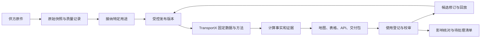

# TransportX 集成设计与演进条件

基线为上游 `7b34bee`，以及 [上下游调研](transportx-upstream-downstream-research.md) 和 [四小时实测](transportx-overnight-exploration.html)。本轮以一个跨午夜枢纽、两份同服务日班表与可控修订验证工作流。真实部署的第一目标是让一项分析经过来源改变、方法升级、跨团队转交后，仍能判断当时依据、现在有效性和需承担的后续动作。

一次业务决定只用得到已经定义清楚的事实。班表描述计划供应，支付或计数记录描述观测，OTP 输出由指定路网与约束算出的路径，SUMO 输出依赖情景和校准。即使它们使用同一站名和日期，也各有时空口径、误差和适用范围。工作台需要传递这些字段及其表达的责任。每次查询的基本单位是“明确问题 + 已固定的数据与方法 + 可检查结果”。图、表、报告和模型回复都从运行取事实。

| 环节 | 最小接口 | 责任与约束 |
|---|---|---|
| 供方与接纳 | 供方命名空间、源标识、原字节摘要、时间、版本前序、适用指标、验收说明 | 保存有效时间与接收时间，迟到补报另出修订。保存源记录和合法关联键。未知、明确无服务、零值和拒绝分别表达。对涉限来源先确定原件、摘要和派生结果可保留及可分发的范围。 |
| 业务发布 | 从当前指针到新版本的原子推进、发布意图、确认回执 | 候选和已发布分别存放。两人对同一基准有不同修订时，由事务决定谁先提交，另一决定返回待复核。重试可核对此前收到的回执。权威数据归属由提供或授权发布的角色负责。 |
| TransportX | 显式修订、内容摘要、方法及代码指纹、参数、事实摘要、运行 ID | 普通模块先复用 Pi 工具、引用与 Canvas。可让 Agent 选工具和解释，工作台的数值、状态和来源直接呈现确定性结果。带前序版本和摘要的句子由工具生成或核验。 |
| 专业计算 | 引擎任务参数、进度、结果引用、假设、可复算等级 | 存档可独立复算的域规则。外部引擎同时固定输入、配置及运行时，异步作业记录意图与可查位置。结果未知时查询原作业，可靠恢复依赖服务端支持。 |
| 工程交付 | 运行清单、按需原件、CSV/GeoPackage、结果字段、内容摘要与操作说明 | 地图要素同时关联对象 ID 和数据版。报表与接收工具验证自己支持的结果语义。数据发布请核对引用关系、许可和接受范围，明确离线副本有自己的到期与复核责任。 |
| 复核与迭代 | 原运行及对象、拟改字段、证据、审批、影响清单、后验观测 | 校审提议发给源或方法所有人。独立复核候选，分类检查数据、规则、表达和工程部署。用留出样本证明行为变化，再为新任务启用。 |

交付时标明能复核到哪一步。接收端可先验证文件和运行清单一致；若要重算，还需要有权取得原始快照、方法的完整依赖和等效运行环境。本轮三份旧包在独立目录通过验包，另带固定版本的方法件后，三次均复算到原运行 ID。若接收方只能获得派生表，报告应明确它能复核文件一致性，原计算需要由有数据访问权的一方复核。

## 影响推演

| 直接变化 | 第二阶使用影响 | 第三阶累积影响 | 试点如何观察 |
|---|---|---|---|
| 数据自动推进 | 同一团队在班表更新前后打开结果，依据可能不同 | 历史报告很难复算，链路里未登记的消费者逐渐不可见 | 记录引用覆盖、旧版可复算率和当前指针推进的失败原因。迟到修订与消费者分页都用固定版本。 |
| 证据和建议更快流转 | 工程师依赖看似熟悉的图或表，复核转为在少数风险处用力 | 输出速度的指标可能掩盖口径错写，责任只剩“模型说过” | 对原始事实、计算结论和建议分别留字段，抽查是否能定位源记录，统计未知被过度解释的比例。 |
| 方法版本更新 | 数据相同，阈值改变能翻转结论。CSV 或地图可能删掉新阈值 | 下游固化旧字段，形成长期兼容成本，同一个指标名承载不同规则 | 同时比对事实和方法版本，按语义而非扩展名验证旧客户端。新字段有版本契约及拒绝策略，旧包照旧复算。 |
| 引用与审批可追溯 | 同一个结果被多部门采用，修订需要找具体受影响者 | 未登记的离线副本无法远程撤回，旧判断可能继续影响下游安排 | 已登记使用项按状态变化、数值变化和仅来源变化分类。记录待处理、已确认与无法确定覆盖的项。历史采用记录保留原版。 |
| 校审反馈进入迭代 | 更容易修正单处记录，校审者也可能只盯该处 | 局部正确的候选累积，可能把其他结论或人群的错误带入新版 | 发布前整份重算。留出时间边界、异常对象和未匹配样本。长期考察错误复现率和观测偏差。 |
| 开放接口对外发放 | 其他 Agent、GIS 或平台能读同一结果 | 多维护一层版本、安全和运行责任，服务中断会被误解为指标空值 | 首版先用文件及有界 CLI。真实共同使用需求出现后，才验收接口、跨进程故障、权限和运维责任。 |

## TransportX 自身怎么迭代

把改进回路接在结果的使用与复核之后。每条反馈至少指向原运行、具体事实、使用目的和反证。TransportX 可以归并类似反馈、提议修复、重放候选方法并生成新旧差异；源数据发布、方法启用和已采用结果的处置各有明确负责人。这样一条反馈可以改善后续任务，也能说明改进是否影响已交付结果。

| 反馈落点 | Agent 可做的事 | 生效的依据 |
|---|---|---|
| 数据：班表迟报或站点映射有误 | 定位原件、提议修订、列出依赖该事实的运行 | 源责任人确认并推进发布版本；旧运行保留原件与方法 |
| 方法：规划可接续但现场上不了车 | 汇集反例、提出候选规则、按日期和通道重放 | 方法责任人比较完整回放与独立留出样本，记录误报和漏报各自的代价 |
| 表达：地图只显示“可接续”，丢了假设 | 识别哪些输出渠道丢字段，生成带假设的候选输出 | 接收方确认新语义能读懂，并验收旧版本能继续打开 |
| 系统：写入期间历史查看卡住 | 给出失败输入与环境，复现并验证修复 | 在同样的并发条件下回归，另外检查用户能区分“暂无结果”和“任务失败” |

观察窗口要覆盖结果交付之后的下一次修订。采用次数上升可以说明工具更常用，也可能只是同一团队形成依赖。先看源证据可定位比例、独立复算成功率、已知重要改动的复核完成情况、以及以现场观测验证的判断误差。对未知的离线使用保留“覆盖未知”，并用抽查估计覆盖范围。用这些证据继续改进技能、数据规则和适配器，避免把上一轮 Agent 的自评变成下一轮的发布依据。

工作台运行时也要单独验收。05:08 首次启动时，Windows 上加载 Pi CLI 的版本检查超过 30 秒并让 Host 退出，未进入查询。下一轮应在目标机器测冷启动耗时分布，区分运行时未就绪、数据源不可用和已有证据仍可回读。对于随产品固定打包的版本，可评估从经过校验的发布清单读取版本，将真实运行探针另行检查；对于自定义运行时，保持显式兼容检查并提供清楚的失败原因。

## 逐步进入真实项目

1. **先在一个有负责人和原始记录可授权重放的枢纽试点。** 仍从计划接续与缺证据开始。定义服务日、时区、对象映射和阈值，记录假设与实际观测的来源。交付运行 ID、CSV/GeoPackage 和可复核说明。验收包括一份可独立重放的旧结果、一次真实修订的影响说明、一次坏数据拒绝。决定质量的指标和数据采集成本一起看。
2. **接入第二种数据时再抽出稳定接口。** 复用版本接纳、运行身份和审阅机制，新增该域的质量规则和时空字段。实时或历史观测必须由数据来源和窗口证明。区域拓扑、空间索引和路由引擎版本随结果保留。用第二种数据验证接口扩展，避免以枢纽数据形状充当通用模型。
3. **消费侧有重复需求后逐步开放。** 需要多个 Agent 时验证持久会话的 MCP 保持同版，需要多个地图项目时用绑定版本的要素查询与发布图层，异步任务有持久状态及业务意图。外部分享对接身份和信任渠道，并定义何时撤回、如何留历史、如何知会已登记使用者。离线包发布时记录接收状态和有效期限。

推进前把四个问题落到责任人。源版本由谁发布，方法由谁改，谁复核对旧结论的影响，谁确认现场结果。如果一个环节只能提供指标摘要或源记录不允许保存，明确可复算等级和未覆盖的范围。更换实现或恢复旧版时仍分配独立操作记录，保持已有发布和采用的历史可追。

第一轮方法试点评估误报可接续与漏报两种损失。成本由运营和工程负责人在试验开始前约定，按时段和通道条件保留独立样本。现场到离站、必要步行、可上车时间与观测缺失分别记录。切分留出样本时按日期或活动分组，避免同批记录既定阈值又评估效果。本轮的 60 秒合成余量说明规则变化后果，具体阈值等实地证据。

身份可分为字节、签发者和当前适用性三类。字节摘要说明原件一致，可信签发渠道确认谁发布，独立的通告说明截至何时允许用于哪类新决定。历史签名还需要可信的签发时间或记录。跨语言复算可先保留原始规范字节，再严格解析业务字段。若统一采用跨语言 JSON 规则，应按既有标准做完整兼容语料。需要组织间交换来源关系时，可用现有的来源数据模型映射试点字段。 [OpenSSH 签名手册](https://man.openbsd.org/ssh-keygen#ALLOWED_SIGNERS) · [RFC 8785](https://www.rfc-editor.org/rfc/rfc8785) · [W3C PROV-O](https://www.w3.org/TR/prov-o/)

本轮原型使用隔离 SQLite、普通 Pi 扩展和合成资料。事务结果支持显式版本、候选完整重算及本机恢复判断。复核人是测试角色，方法中的登乘余量属于反事实探索。部署前另验收机构身份、授权来源、跨进程隔离、重放保存期及代表性现场数据。
