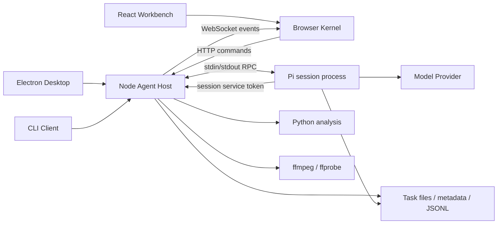

# TransportX Agent 架构审查与优化意见

> 文档日期：2026-10-10
> 当前本地基线：`codex/desktop-updates-release-workflow`，HEAD `01a9fb9d580d942f3f1a027c9edb67492a2ac0a3`，产品版本 `3.22.0`。
> 文档性质：架构审查、风险判断与渐进整改建议；不是已完成整改记录，也不替代当前架构说明。
> 输入材料：本对话此前的本地代码审查，以及用户提供的《TransportX Agent 审查复核与整改路线图》（2026-10-10）。附件中的“立即启动”、Issue 拆分和模型示例作为建议材料处理，不构成本轮修改代码、创建 Issue 或发布的授权。

## 0. 决策摘要

**保留模块化单体架构。优先修复认证、命令与消息关联、权威恢复、资源所有权和生命周期边界。暂不重写，不拆微服务，不引入平台级数据库，不更换前端状态库。**

项目已经具备支持长期演进的骨架：Electron 与业务 Host 分离、每任务 Pi 进程、按任务冻结模块和运行时、独立 Browser Kernel、HTTP 命令与 WebSocket 事件分离，以及受控领域资源服务。主要问题不是缺少层次，而是多个边界之间仍依赖隐式约定：失败命令的上下文由谁清理，Snapshot 能否覆盖旧分支，历史文件何时没有 Writer，内部 token 能否通过用户认证门禁。

未来功能增长的成本主要由四个根因决定：

1. **身份与失败语义不完整**：用户凭据、服务 token、命令 ID、消息 ID 缺乏明确映射；拒绝与超时处理不一致。
2. **状态权威与顺序不明确**：JSONL、Host 投影、WS 事件和客户端 overlay 在恢复时没有统一校正规则。
3. **资源所有权与生命周期不完整**：请求临时文件、会话 Writer 和分析作业的创建、停止、删除未统一协调。
4. **策略与依赖分散**：同类资源经过不同路由时保证不同；运行时实例通过 import 初始化，测试和业务依赖全局状态。

建议设置两道验收门槛：

- **安全与数据正确性门槛**：解决 C1、H1、H2 的明确拒绝处理、H4、H5，以及请求超限后继续缓存的问题。同时完成 H6 的模型失败与重试状态展示，避免失败表现为无响应。在通过前不扩大远程访问范围。
- **可靠恢复门槛**：解决消息关联、命令未知态、Snapshot 当前分支校正和会话作业回收。在通过前不把“可靠交付”或“断线自动恢复”描述为覆盖所有故障场景的保证。

## 1. 审查依据与验证边界

### 1.1 三份基线不能混用

| 来源 | 基线与性质 | 可以支持的结论 |
|---|---|---|
| 本对话此前的原始审查 | 本地代码阅读、类型检查、默认测试与隔离复现；此前未在报告中记录 Git SHA | 支持当时的检查结果和复现记录，不自动等同于新基线的完整验收 |
| 用户提供的复核附件 | 标注 GitHub `main`、HEAD `8fd1a524284410532366b8f902a7de7b3b0f0acb`；附件声明只做代码比对，未独立跑测试 | 支持复核意见、整改依赖与风险解释；其远端 SHA、提交说明是附件记录，本轮未独立访问远端验证 |
| 本轮整合 | 当前本地 HEAD `01a9fb9d580d942f3f1a027c9edb67492a2ac0a3`；重新核对关键代码并生成文档 | 支持文档基线、重点路径仍存在及整改建议；本轮没有重新运行默认测试或实施修复 |

两份代码基线不同，不能将附件标注的 `main` 行号直接作为当前本地证据。本文件使用仓库相对文件链接和函数名定位；问题关闭时应重新记录实施后的 SHA。

### 1.2 证据标记

- **F — 代码事实**：有文件、函数和调用关系支撑；不等于真实部署漏洞或端到端故障已复现。
- **R — 前次隔离复现**：本对话此前用独立对象、模拟 transport 或临时目录复现；不是本轮再次执行，也不代表所有平台行为。
- **V — 待验证风险**：静态实现支持风险判断，实际后果取决于网络、Pi 协议、浏览器、进程或并发时序。
- **T — 目标建议**：整改后的状态或设计选择，当前实现不一定具备。

等级表示影响与处理优先级，证据标记表示可信度；二者独立。

### 1.3 已做与未做

前次审查执行了 `npm run typecheck` 和 `npm test`，均通过；默认测试报告为 **40 个注册套件通过**，不是只有 40 个细粒度场景，也不意味着本文回归矩阵均已覆盖。前次静态 TypeScript 运行时 import/export 扫描未发现循环，扫描不覆盖全部动态加载和 `require`。

前次隔离复现记录包括：失败 ACK 后上下文队列残留、执行中命令被缓存淘汰后重复执行、失败上传破坏另一上传、Kernel 重连未主动拉 Snapshot，以及权威新分支 Snapshot 保留旧分支 entries。内部认证门禁也做了隔离检查：token-only 请求在服务 token 验证前被用户认证返回 401。

补充验证（DeepSeek 无响应分析）：以合成 `message_end` 错误消息和 `auto_retry_end` 事件注入现有 Browser Kernel，确认错误消息进入历史后，运行态结束、连接仍为 connected，而 `runtime.lastError` 仍为 null。结合组件过滤条件，可确认无正文错误缺少展示入口；这不是一次真实 DeepSeek API 失败复现。用户仅测试了 API／新会话短问题，报告用户的应用版本可能不同，均使用官方 API；尚未取得失败会话的原始错误，不能确定上游触发原因。

尚未完成：真实 Pi 全工具端到端、浏览器 SVG 导航安全验证、资源压力测试、Windows 文件占用与进程树回收、正式签名跨版本更新、仓库外 CI 和生产监控核查。不得将这些事项写为已经通过。

## 2. 项目架构理解

### 2.1 业务目标与核心领域

**F：**TransportX Agent 是本地交通分析工作台。分析人员围绕任务发起对话，使用地图、视频、知识和数据能力，补充上下文，形成带引用的报告与成果文件。

核心领域不是通用聊天，而是：

- **任务与对话生命周期**：创建、恢复、发送、交互等待、终止、历史管理。
- **任务能力装配**：Domain、Module、Skill、Extension、Data、Knowledge、Template、Native Runtime 的选择、校验和冻结。
- **分析成果与证据**：Geo、Video、Citation、Document、Canvas 的受控发布、版本和定位。
- **用户上下文**：附件、地图选区、Canvas 选区与本轮消息的关联。

城市数据库、知识检索和报告模板通过 Module 贡献，平台不应直接承担特定城市的数据规则。

### 2.2 运行时拓扑



**F：**桌面入口、CLI 和 Web 共用 Host 业务实现。Electron 提供窗口、生命周期、PDF、更新和本机能力；Node Host 管理会话及资源；Pi 执行模型循环和工具。Python/ffmpeg 由 Host 受控服务调用，但 Pi 的基础 `bash` 也能直接运行脚本，不能把所有工具描述成经过 Host 的 OS 沙箱。

实现入口：[server-main.ts](../src/server/server-main.ts)、[desktop/main.ts](../desktop/main.ts)、[transportx.ts](../src/server/transportx.ts)。

### 2.3 模块职责与依赖方向

| 模块 | 当前主要职责 | 应保留的依赖方向 |
|---|---|---|
| `src/contracts` | 跨层协议、解析、诊断、版本和分支选择 | 不依赖 Node、React、Electron 或具体 Viewer |
| `src/server` | HTTP/WS、会话、装配、运行时、资源与配置 | 消费 contracts、文件/进程基础设施和领域服务 |
| `modules` | Skill、Extension、资产和 Native Runtime | 使用平台契约或内部服务协议，不复制工作台业务 |
| `src/public/kernel` | 事件归一化、Action、Dispatcher、Store 和命令端口 | 依赖 contracts；不依赖 React/DOM |
| `src/web` | 交互、领域投影、Canvas Adapter、Viewer 和样式 | 消费 Kernel 与 contracts |
| `desktop` | 桌面生命周期、Host supervisor、更新、打包 | 复用 Host，不新增另一套会话服务 |

**F：**大部分方向已经成立；但 Host 内部组合仍依赖全局配置实例，会话对象跨多个领域，部分 React Viewer 直接 fetch。直接 fetch 不应机械禁止：二进制流、HEAD 与取消是合理适配用途；关键是复用相同资源授权和版本语义。

### 2.4 数据与状态流

1. **任务创建**：Session Profile → Registry 依赖闭包 → Asset Resolver → Resolved Session Plan → Pi 启动参数、环境和 cwd。
2. **消息发送**：HTTP RPC → 校验附件/Geo/Canvas → 拼接工具上下文 → Pi 命令 → ACK 和消息事件。
3. **稳定历史**：Pi JSONL → 当前分支选择 → 附件、Geo、计时补充 → Host Projection → Snapshot。
4. **实时展示**：WS 原始事件 → Normalizer → Action → Dispatcher → Stores → React View Model。
5. **成果读取**：sessionId + 路径/resourceId → 目录、manifest、版本或哈希校验 → 内容响应 → Viewer。

实现依据：[session-assembly.ts](../src/server/session-assembly.ts)、[session-pi-launch.ts](../src/server/session-pi-launch.ts)、[session-projection.ts](../src/server/session-projection.ts)、[app-kernel.ts](../src/public/kernel/app-kernel.ts)。

### 2.5 模型与持久化边界

| 概念 | 当前形式 | 需要明确的边界 |
|---|---|---|
| Protocol/DTO | Pi 原始事件、宽 RPC 命令、Session Snapshot、领域 envelope | 外部输入必须解析；TS 类型断言不能代替验证 |
| Host 领域状态 | PiRpcSession、实时投影、交互请求、服务 token | 生命周期和失败状态不应靠 UI 顺序推断 |
| Persistence Model | Pi JSONL、`.tau` JSON、用户配置 | schema、损坏、写入所有权与恢复策略 |
| View Model | 消息、工具卡片、能力概览、Canvas projection | 不拥有文件删除安全性或服务端事实判定 |

**F：**平台没有统一业务数据库。SQLite 是模块资产；事务主要靠同步操作、文件原子替换、异步确认及应用层协调。不能把所有文件读改写都判定为并发竞态：同一 Node 事件循环中的同步段不会互相交错；应优先检查跨 `await`、缓存快照和多 Host 写入。

### 2.6 认证、授权和执行信任

**F：**用户认证采用共享 Basic 凭据及签名 Cookie；工具访问 Host 使用按会话、按服务发放的 token。不存在用户主体、租户 ID、会话 owner 或按主体过滤 WS 事件的模型；Manager 向全部连接广播。

**推断：**当前产品采用“单用户、本机、可信 Module”模型。Session 目录隔离和服务 token 是资源边界，不是多租户隔离。Pi 和 Module 可运行本机代码；即使内部 HTTP token 分服务，也不能据此声称同一 Pi 进程中的插件互相隔离。

多用户共享服务属于独立产品决策，需要身份、所有权、订阅授权和执行隔离；本轮不建议预先植入未使用的 tenant 字段。

### 2.7 测试、诊断与部署

**F：**已有默认场景套件、Web fake Pi 冒烟、真实 Pi 冒烟、macOS/Windows 平台验收入口；构建与发布流程检查运行时、签名和产品版本。Desktop Supervisor 有日志与启动健康检查，计时 Store 提供分析耗时信息。

**V：**仓库外 CI、服务指标与故障上报未核查。计时数据不等同于 Host 运行监控；默认套件通过也不等同于真实 Pi、OS 进程树或安装器通过。

## 3. 值得保留的设计

1. **单一业务 Host。** 桌面、CLI、Web 不重复会话与领域服务，降低多入口行为漂移。
2. **按任务冻结装配结果。** 精确模块版本、入口和 Native Runtime 哈希可支持恢复与追溯，不应改成静默使用最新版本。
3. **Pi 独立进程。** 提供明确生命周期和协议适配点，避免模型框架直接渗入 React。
4. **独立 Browser Kernel。** Transport 和 HTTP 可注入，状态恢复能通过测试固定。
5. **命令与事件分离。** HTTP 承担副作用确认，WS 承担实时事件；不建议恢复 WS 副作用命令。
6. **具体领域服务和可信 Adapter。** Geo、Citation、Video 等能力有各自语义，不需要统一成万能业务 Service；Canvas 不动态加载任意模块前端代码。
7. **资源保护已有实现。** 引用哈希、ZIP 路径/解压校验、Office 大小限制与延迟加载可作为后续规则的依据。
8. **已有回归与发布纪律。** 40 套件预算、Module 版本冻结、平台打包和用户数据保留规则适合继续沿用。

## 4. 问题总览

| 等级 | 编号 | 问题 | 证据 | 建议阶段 |
|---|---|---|---|---|
| Critical（有条件） | C1 | 非桌面 Host 默认所有网卡监听且可能无鉴权 | F / V | Phase 0 |
| High | H1 | 用户认证门禁阻断内部服务 token | F / R | Phase 0 |
| High | H2 | 上下文 FIFO 归属，失败 ACK 留下待处理引用 | F / R / V | Phase 0 止血，Phase 1 根治 |
| High | H3 | 重连不拉活动 Snapshot，hydrate 保留旧分支 | F / R | Phase 1 |
| High | H4 | 失败上传清理其他请求临时文件 | F / R | Phase 0 |
| High | H5 | Writer 未停止即能删除历史 | F / V | Phase 0 |
| High | H6 | 模型错误与重试状态不可见，失败表现为无响应 | F / 补充隔离验证；真实触发原因待确认 | Phase 0 |
| Medium | M1 | 执行中命令可被去重缓存淘汰 | F / R | Phase 1 |
| Medium | M2 | 请求、作业、WS、缓存缺少总容量与取消策略 | F / V | Phase 0 / 1 / 3 |
| Medium | M3 | 文件替换与写入一致性混用，损坏状态退为空 | F / V | Phase 2 |
| Medium | M4 | 资源真实路径、哈希与主动内容策略不一致 | F / V | Phase 2 |
| Medium | M5 | 全局初始化、会话职责交汇与宽 RPC 边界 | F | Phase 1 / 2 |
| Medium | M6 | 全 Store 订阅及导航迟到结果 | F / V | Phase 2 / 3 |
| Low | L1 | 细粒度测试、诊断、文档和平台规则漂移 | F / V | Phase 3 |

### C1 — 非桌面入口可能暴露无鉴权的本机 Agent

- **问题与证据（F）：**`config.ts::loadTauSettings` 将非桌面默认 host 设为 `0.0.0.0`；`server-main.ts` 的 `authEnabled` 依赖已配置 user/pass，且设置可关闭认证。`isAllowedApiOrigin` 允许无 Origin 请求，不能替代身份认证。依据：[config.ts](../src/server/config.ts)、[server-main.ts](../src/server/server-main.ts)。
- **结构性原因与长期影响：**网络暴露、身份认证和本机工具权限没有绑定。网络访问者可能控制任务、配置及工具执行；共享凭据和全量广播也不支持多用户所有权。
- **成立条件（V）：**非桌面 Host 无鉴权且端口对其他机器可达时为 Critical。默认桌面/CLI 回环监听不因此被判定为同等风险；防火墙、代理和实际部署需要单独确认。
- **目标（T）：**默认回环；非回环显式开启远程模式并要求有效认证，不能通过关闭认证降级。明确受信代理和 TLS 的部署边界。
- **最小实施：**集中启动门禁；区分默认本地和显式远程访问，不引入未使用的用户/租户框架。
- **风险与范围：**改变非桌面启动默认值，需要迁移说明；桌面和 CLI 回环行为应保留。未完成共享服务授权和执行隔离前，不承诺多租户。
- **验收：**默认启动仅本机可用；无认证远程启动失败；已有显式认证部署与内部工具链联合通过。

### H1 — 两类认证主体共用门禁，内部服务 token 无法到达验证点

- **问题与证据（F/R）：**`static-handler.ts::serveStaticFile` 在内部 API 前检查 Basic/Cookie；Citation、Geo、Spatial Extension 请求只携带 JSON 中的 session/service token；`api-routes.ts::resolveServiceSession` 位于后面的 Router。CLI 创建随机 Basic 凭据。前次隔离检查得到 401，服务 token 验证未执行。依据：[static-handler.ts](../src/server/static-handler.ts)、[api-routes.ts](../src/server/api-routes.ts)、[Citation Extension](../modules/capabilities/citation/extensions/pi-citation/index.ts)、[transportx.ts](../src/server/transportx.ts)。
- **结构性原因与影响：**浏览器用户和内部工具没有分别识别；启用用户认证会阻断正常领域能力，fake Pi 场景可能没有经过真实内部 HTTP 路径。
- **目标（T）：**用户 API 使用用户认证；内部 API 使用对应 session/service token，严格检查服务范围、会话状态及允许的路由。来源检查只能补充，不能替代 token。
- **最小实施：**分开认证入口，同时限制内部路由注册和输入解析；不裸放行 `/api/internal/*`，不向插件分发全局管理员密码。
- **风险与范围：**HTTP 总入口和 Host-backed Extensions。若修改模块脚本，须同步提升 manifest 版本和 CHANGELOG。
- **验收：**未认证用户失败；合法工具 token 可调用对应服务；无 token、跨会话、跨服务或未获准能力调用失败。

### H2 — 消息上下文依赖顺序，拒绝与超时容易改变归属

- **问题与证据（F/R）：**`rpc-handlers/native.ts` 发送前分别登记附件、Geo、Canvas；`success:false` 直接返回，只有 catch 清理。`sessions.ts::trackMessage` 在用户消息开始时分别 `shift()`。前次复现失败 ACK 后附件队列仍残留。依据：[native.ts](../src/server/rpc-handlers/native.ts)、[sessions.ts](../src/server/sessions.ts)。
- **结构性原因与影响：**命令身份与消息身份没有稳定关联，三条 FIFO 依赖同一事件顺序；会导致附件、选区、引用归属错误，影响分析结果追溯。
- **待确认（V）：**Pi 是否提供可贯穿 ACK 和用户消息事件的 ID；steer/follow_up、迟到事件及重复内容的真实顺序。
- **目标（T）：**统一待发送记录，以 commandId 管理上下文，明确成功、拒绝和未知态。可靠消息 ID 不可用时，采用受控串行或明确过渡匹配规则。
- **最小实施：**先在明确拒绝时撤销该命令记录；不要通过数组内容删除同内容的其他请求。随后统一 PendingMessage 并核实 Pi 关联协议。
- **风险与范围：**prompt、steer、follow_up、历史引用恢复。当前 catch 对超时也清理，不能直接照搬为目标：超时可能已执行，应保留未知态等待校正。
- **验收：**拒绝后发送下一条不串上下文；相同附件连续提交不误删；超时后迟到消息、并发提交和中止均有确定归属。

### H3 — 稳定历史与实时 overlay 没有权威恢复规则

- **问题与证据（F/R）：**WS 连接只发送活动列表；App 在重连后刷新列表，没有自动拉取活动会话 Snapshot；`ConversationStore.hydrate` 将新 Snapshot 追加到旧 entries。前次 Kernel 复现无重连 Snapshot 请求；旧 `[old]` 与新权威分支 `[new]` 得到 `[old,new]`。依据：[websocket-handler.ts](../src/server/websocket-handler.ts)、[App.tsx](../src/web/app/App.tsx)、[conversation-store.ts](../src/public/kernel/stores/conversation-store.ts)。
- **结构性原因与影响：**事件、投影和持久事实之间缺少覆盖与顺序规则。断线最终消息缺失，旧分支不退出，交互请求和工具成果可能不同步。
- **目标（T）：**Snapshot 表示当前分支的权威稳定视图；只保留可识别且确属未完成的 overlay。Snapshot/事件使用会话代次与 revision 或等价顺序机制。
- **最小实施：**重连校正活动会话；替换稳定 entries；对已知协议补充顺序保护，而不是为每个 Viewer 分别设计恢复协议。
- **风险与范围：**流式对话、工具状态、Canvas、等待交互。若增加 revision，必须说明 Host 重启后如何生成新代次；只有内存计数器不能保证跨重启顺序。旧新客户端兼容须独立评估。
- **验收：**断线期间完成的稳定结果补齐；分支切换删除旧消息；旧 HTTP Snapshot 不覆盖新事件；切换会话和恢复中交互终态一致。

### H4 — 上传请求没有独立清理所有权

- **问题与证据（F/R）：**`saveUploadedAttachments` 共用 `.tau/attachment-tmp`；解析失败时遍历删除整个目录。前次临时目录复现：B 失败清理 A，A rename 报 `ENOENT`。依据：[session-attachments.ts](../src/server/session-attachments.ts)。
- **结构性原因与影响：**资源属于请求，清理按会话范围执行；并发请求相互破坏，句柄和临时产物释放也难以说明。
- **目标（T）：**每次上传拥有独立 temp 目录与句柄；清理只影响本请求。
- **最小实施：**请求级临时目录，解析器异常/断连路径统一 finally 关闭句柄；限制总字节和文件数，保留超限可读错误。
- **风险与范围：**附件解析和索引发布。附件记录的“超 50 MB 可读错误”变更不等同于 H4 修复。不能为了停止缓存，重新导致客户端只见 `Failed to fetch`。
- **验收：**A 正常/B 失败时 A 成功；多请求中断互不影响；无临时文件或句柄遗留。两个成功请求是否丢索引是补充验证项，尚未证实，不能直接列为既成问题。

### H5 — 历史删除没有等待唯一 Writer 退出

- **问题与证据（F）：**`LiveSessionManager.delete` 启动 terminate 后立即移除注册并返回；`/api/sessions/delete` 直接 unlink，不检查 active/pending resume/terminating writer。依据：[sessions.ts](../src/server/sessions.ts)、[api-routes.ts](../src/server/api-routes.ts)。
- **结构性原因与影响：**UI 的“先关闭再删除”承担了服务端安全责任，但关闭 ACK 不是进程停止确认；直接调用删除接口也能绕过顺序。可能数据丢失、重建或平台文件占用失败。
- **待验证（V）：**真实 Pi 写回方式、POSIX 打开句柄与 Windows 文件锁的实际后果，不能断言所有平台必然重建文件。
- **目标（T）：**删除由生命周期协调，先阻止新恢复、等待 Writer 停止，再删除；确认失败时保留历史文件。
- **最小实施：**按规范化历史文件身份协调 close/resume/delete；快速关闭可表达 closing，不将它当作 deleted。不要删除长期必要的终止状态过早。
- **风险与范围：**关闭、恢复、历史删除、退出。需要确定重入删除和重复关闭的幂等语义。
- **验收：**streaming 关闭后立即删除、并发 resume/delete、进程未响应、Windows 文件占用都有确定终态，没有旧 Writer 在删除后继续发布。

### H6 — 模型失败与重试状态缺少用户可见出口

- **问题：**问题已发送但模型没有生成正文时，失败消息可能留在历史数据中而不显示。自动重试也缺少进度和最终结果反馈，用户无法区分等待、重试、失败和连接中断，容易重复提交。
- **代码证据（F）：**[ConversationWorkspace.tsx](../src/web/platform/conversation/ConversationWorkspace.tsx) 中 `showMessage` 只检查正文或可展示的思考内容；[message-cards.tsx](../src/web/platform/conversation/message-cards.tsx) 的 AssistantMessage 没有展示 `stopReason/errorMessage`；[event-normalizer.ts](../src/public/kernel/event-normalizer.ts) 把 `message_end` 转为 `streamCompleted`，未将模型错误映射为可见失败状态，并忽略 `auto_retry_start/auto_retry_end`；[conversation-store.ts](../src/public/kernel/stores/conversation-store.ts) 保存错误消息但未建立对应运行失败投影。
- **补充隔离验证：**注入无正文、`stopReason: error`、带合成 `errorMessage` 的 assistant 消息，再注入失败重试结束和 `agent_settled`，得到 `live.active=false`、连接为 connected、`runtime.lastError=null`，历史仍包含错误消息。组件条件不会渲染该错误卡片。验证使用模拟事件，没有调用真实模型，也没有证明用户报告必由 HTTP 400 引起。
- **结构性原因与长期影响：**RPC 命令确认、模型执行结果、重试生命周期和连接状态缺少清晰的展示边界。命令 ACK 只表示预检/接收成功，不等于模型回答成功；本地 WebSocket 已连接也不等于上游 API 请求成功。新增模型或更复杂工具任务后，同一缺口会持续隐藏不同故障，增加重复执行、误诊和支持成本。
- **目标（T）：**每轮会话能展示等待响应、生成、工具执行、重试、完成、失败、用户取消；优先复用已有状态，缺少的失败/重试信息按 sessionId 与本轮运行归属投影。空正文和已有部分正文的失败都必须可见；恢复历史后仍能看到该轮失败。用户取消单独显示，不伪装成模型错误。
- **最小实施：**先允许错误消息独立渲染，在对应回答位置显示失败原因和可用操作；再消费重试开始/结束事件，展示当前次数、等待与最终失败。复用现有 Kernel、Store 和错误契约，不引入新状态库或依赖。现有字段不足时评估外部协议兼容，不使用全局 lastError 代替每轮失败归属。中间重试失败标记为重试过程，成功后清除活动重试提示，避免重复失败通知。
- **反馈与诊断：**用户看到经脱敏的原因、重试/取消入口及诊断标识；诊断保留应用/Pi 版本、模型、API 协议、sessionId、可关联的 commandId/runId、错误分类及分阶段耗时。禁止原样展示或导出密钥、完整请求体、提示词、思考内容和敏感工具结果；复用现有日志并限制保留量。HTTP 超时或交付未知不得直接变为可安全重发，不增加无限重试。
- **风险与影响范围：**对话展示、Kernel 事件转换、会话状态投影与诊断；重点防止后台会话错误污染当前会话、旧轮错误覆盖新轮、模型错误与工具错误混淆、主动取消被误报，以及一键重试重复已经执行的工具副作用。优先基于现有历史字段实施，无存储迁移，可独立代码回滚。
- **验收：**无正文错误、部分正文后失败、重试后成功、重试耗尽、取消、历史恢复、切换会话均有正确反馈；错误提示具有可访问状态语义，操作可用键盘访问；诊断脱敏；正常流式和工具展示不回归。先在既有 suite/case 加合成事件与浏览器用例，再用统一版本/配置执行 DeepSeek 的短问题、工具后追问和旧会话恢复测试。真实上游失败原因作为独立诊断项，不以展示功能完成代替根因修复。

### M1 — 去重缓存未区分执行中与结果未知

- **问题与证据（F/R）：**Ledger 按 TTL/容量直接删除条目；执行中 Promise 也会被淘汰。前次容量为 1 的复现中 A 被 B 挤掉，再提交 A 执行两次。客户端 pendingPromptIds 保留失败 ID，服务端缓存失败响应，明确拒绝后的重试可能一直返回原失败。依据：[rpc-command-ledger.ts](../src/server/rpc-command-ledger.ts)、[commands.ts](../src/public/kernel/commands.ts)。
- **结构性原因与影响：**缓存替代了命令状态机，结果未知和未执行无法区分；容量、重试或重启会改变副作用次数。
- **目标（T）：**区分 in_flight/succeeded/rejected/unknown；执行中不淘汰；同 ID 不同 payload 冲突；明确去重期限与重启边界。
- **最小实施：**执行中与完成条目分别管理，容量不足时拒绝新增或背压；明确拒绝且用户决定重新执行时创建新 ID。未知态沿用原 ID 查询或校正，不能简单重发。
- **风险与范围：**可靠 RPC、队列重试。只有跨重启可靠恢复成为真实需求时才持久化账本；不承诺无条件 exactly-once。
- **验收：**相同 ID/载荷共享结果；载荷冲突拒绝；活跃命令不被淘汰；超时迟到与故障重启符合已声明语义。

### M2 — 单次限制没有形成总容量和作业所有权

- **问题与证据（F）：**readBody 超限 reject 后仍追加；stdoutBuffer 缺少帧上限；broadcast 不看发送缓冲；ProcessRunner 没有并发门槛；Video 支持 AbortSignal，但路由未传入；PDF Buffer 缓存没有总字节/条目上限，过期清理依赖后续请求。依据：[server-main.ts](../src/server/server-main.ts)、[sessions.ts](../src/server/sessions.ts)、[process-runner.ts](../src/server/process-runner.ts)、[api-routes.ts](../src/server/api-routes.ts)。
- **结构性原因与影响：**timeout 和单文件大小只约束单次操作，多作业、慢客户端与断线可以累积资源；关闭会话未必停止其 Host 作业。
- **待验证（V）：**CPU、内存、缓冲和孤儿进程实际规模需压测；不能据此宣称所有正常操作都会耗尽资源。
- **目标（T）：**作业绑定 session/operation owner；Host 与会话有容量上限；取消、停止和回收有明确终态。
- **最小实施：**先停止超限累计；按实际 Python/Video/PDF 并发需求设门槛；慢 WS 断开后 Snapshot 恢复；缓存计字节并定期清理。核实 execFile timeout/abort 是否能回收整个进程树。
- **风险与范围：**HTTP/WS、Pi stdout、Python、Video、PDF。浏览器断线不自动等同于业务取消，允许后台继续的作业须保留。
- **验收：**超大 body、异常无换行帧、慢 WS、并发作业和未领取 PDF 均有可测资源上界；session 停止后应停止的作业和子进程树被回收。

### M3 — 原子写不等于并发一致性，损坏不应当作空状态

- **问题与证据（F）：**saveTauSetting 直接覆盖配置，读取失败退为空对象；附件索引损坏退为空；deletePiModelProvider 在 await 前读 models，在 await 后写回旧快照；CLI 与桌面可共用用户目录。依据：[config.ts](../src/server/config.ts)、[session-attachments.ts](../src/server/session-attachments.ts)、[pi-model-config.ts](../src/server/pi-model-config.ts)、[transportx.ts](../src/server/transportx.ts)。
- **结构性原因与影响：**missing/corrupt/unsupported 没有区分，写入 owner 不明确；旧快照覆盖和损坏文件再写会减少可恢复信息。
- **待验证（V）：**跨 await 丢更新与多 Host 并发写需专门验证；不能把同进程同步写入一概判为并发丢更新。
- **目标（T）：**关键 JSON 原子替换、保留可恢复旧版，损坏时保留证据；确实存在的读改写竞争串行化。
- **最小实施：**先声明单 Host/多 Host 支持范围；单 Host 对跨 await 配置操作排队，多 Host 若获支持再使用目录租约/文件锁。不要用反复读取掩盖所有权问题。
- **风险与范围：**用户配置、模型和任务元数据。修复需要恢复样例和备份策略，不迁移为数据库。
- **验收：**中断写入可恢复；损坏不被静默空覆盖；异步配置更新不丢失；明确拒绝不受支持的多 writer 场景。

### M4 — 同类资源经过不同入口时保护不同

- **问题与证据（F）：**Geo 路由检查 manifest 哈希格式和数据大小，却不重算实际 SHA，仍将 manifest 哈希用作 ETag；resolveSessionFile 词法判界后 stat 跟随链接；Citation SVG 有 sandbox CSP，普通文件 preview/raw 没有同等策略。依据：[geo-resources.ts](../src/server/geo-resources.ts)、[server-main.ts](../src/server/server-main.ts)、[citation-resources.ts](../src/server/citation-resources.ts)、[file-api-handler.ts](../src/server/file-api-handler.ts)。
- **结构性原因与影响：**安全保证由路由而不是资源语义决定；新 Viewer 容易绕过完整性或主动内容保护。Geo 同长度变化不被大小检查发现，分析复现可能读取不同内容。
- **待验证（V）：**SVG 直接导航的脚本风险需浏览器验证；现有 img 预览不能直接认定为已证实 XSS。词法链接路径也不等同于无条件远程越权。
- **目标（T）：**资源策略表统一真实根目录、文件类型、版本、哈希、MIME、CSP 和下载语义。
- **最小实施：**复用已有安全原语；Geo 版本校验与 ETag 对齐；历史真实路径检查；SVG/HTML 主动内容保持一致约束。大资源哈希缓存应基于明确不变条件，不能仅凭大小。
- **风险与范围：**Geo、Citation、普通文件及历史导出；哈希增加 I/O 成本，真实路径策略可能影响现有合法软链，应先列出支持规则。
- **验收：**同长度 Geo 替换被发现；越界软链不可读；SVG 直接导航受控；普通文件不能成为引用版本检查的旁路。

### M5 — import 初始化与职责交汇扩大变更面

- **问题与证据（F）：**config 在导入时创建 Registry/Installer/Assembler；sessions 直接依赖全局实例、服务 endpoint、Geo singleton 和测试 spawn 替换点。PiRpcSession 同时负责进程、协议、消息关联、标题、能力、计时及领域上下文。RpcCommand 允许任意字段，多个 HTTP 消费点只有类型断言。依据：[config.ts](../src/server/config.ts)、[sessions.ts](../src/server/sessions.ts)、[types.ts](../src/server/types.ts)、[commands.ts](../src/public/kernel/commands.ts)。
- **结构性原因与影响：**新入口和测试依赖环境变量及 import 顺序；每个新领域扩大 Session 修改面。文件超过 500 行只是信号，职责交汇才是原因。
- **目标（T）：**配置解析与实例创建分离；组合根显式连接现有具体组件。Session 保留进程、传输、生命周期与最小状态；领域服务保留自身语义。
- **最小实施：**先注入已有实例；统一 PendingMessage 和生命周期协调；再移动代码并删除失效全局入口。优先验证副作用命令和恢复 Snapshot，不一次替换所有宽类型。
- **风险与范围：**启动、会话、测试、契约。不要同时更改目录、协议和行为；保留迁移期只有必要的外部兼容，不新增长期内部 shim。
- **验收：**测试能构造独立 Host/Manager；桌面、CLI、Web 启动一致；坏 DTO 被边界拒绝；不引入新循环依赖。

### M6 — 导航完成顺序与订阅范围没有跟随会话边界

- **问题与证据（F）：**useSyncExternalStore 订阅整个 Store；ConversationWorkspace 消费全会话状态、历史工具投影和全部 entries。App 的 selectSession 共用 loading/notice，无请求代次；selectHistory 完成后可以激活不再是最新选择的会话。依据：[store-hooks.ts](../src/web/app/store-hooks.ts)、[ConversationWorkspace.tsx](../src/web/platform/conversation/ConversationWorkspace.tsx)、[App.tsx](../src/web/app/App.tsx)。
- **结构性原因与影响：**后台变化扩大渲染范围；长历史增加投影与 DOM 成本；旧请求回写污染新会话 loading/error 或活动选择。
- **待验证（V）：**性能瓶颈应采样；没有基准不应直接新增虚拟列表依赖。loading/notice 竞态和活动选择竞态需要各自用例。
- **目标（T）：**按 sessionId 订阅稳定切片；导航有 generation/取消；每次请求 loading/empty/error/retry 对应正确会话。
- **最小实施：**复用 Document/Office 中迟到结果保护的语义；对导航请求加代次，先测量再考虑窗口化。维持当前 Kernel。
- **风险与范围：**App、Store hooks、对话渲染；选择器须返回稳定引用，不能制造新的全量订阅抖动。性能优化不能破坏键盘焦点、阅读顺序与滚动。
- **验收：**A→B 后旧 A 成功/失败不覆盖 B；关闭后迟到响应无回写；后台流式事件不导致无关视图大面积重渲染；长历史基准可比较。

### L1 — 测试、诊断和设计上下文不足以说明故障

- **问题与证据（F）：**自定义 registerSuite 顺序执行 case，skip/todo 直接跳过，标准报告缺少细粒度独立状态；JSONL 损坏行和部分消费者异常被静默忽略；ARCHITECTURE 标注 3.2.0 且部分模块/恢复保证与代码不一致；业务文件仍存在分散 OS 分支。依据：[test-suite.ts](../test/support/test-suite.ts)、[session-projection.ts](../src/server/session-projection.ts)、[websocket-client.ts](../src/public/websocket-client.ts)、[ARCHITECTURE.md](./ARCHITECTURE.md)、[file-api-handler.ts](../src/server/file-api-handler.ts)、[platform-profile.mjs](../desktop/scripts/platform-profile.mjs)。
- **结构性原因与影响：**门禁数字无法解释覆盖缺口；正常空状态、损坏与逻辑异常混同；维护者根据过时保证增加功能，平台规则失去单一来源。
- **目标（T）：**保留 suite 预算，用原生 subtest 报告 case 状态；诊断能串起 command/session/job；设计规则有简短 ADR 和移除条件。
- **最小实施：**缺失与损坏分类日志、结构化错误和关联 ID；默认不记录密钥、附件或原始 prompt。平台操作收敛到边界 helper，但不为统一文件结构重构无关业务。
- **风险与范围：**测试 runner、日志、文档、平台操作；日志需有大小/保留上限，避免把敏感内容作为错误上下文透传。
- **验收：**case 名称、跳过和失败能定位；故障可关联到命令和作业；文档保证有测试或明确限制；两平台关键操作实际验证。

## 5. 推荐目标架构

### 5.1 最小边界

保持现有目录和进程形态。下面是责任边界，不要求机械新建同名目录或接口层。

| 边界 | 应拥有的责任 | 不应承担的责任 |
|---|---|---|
| HTTP/WS 适配 | 主体认证、输入解析、受控错误、事件传递、入口容量 | 内嵌 Pi 状态或替 UI 决定领域事实 |
| Session Lifecycle | create/resume/send/close/delete、Writer 协调、PendingMessage 和作业 owner | GIS 算法或 Viewer 细节 |
| Pi Transport | 命令帧、ACK、超时、退出和事件适配 | React 状态或最终资源授权 |
| Domain Services | Citation、Geo、Canvas、Spatial、Video 的业务规则和资源语义 | 全局配置初始化和鉴权例外 |
| 文件/进程基础设施 | 真实路径、原子写、哈希、temp、进程树 | 跨业务隐式状态合并 |
| Kernel/React | 权威 Snapshot 与事件到 View Model，交互和反馈 | 文件删除安全性或无依据的服务端状态推测 |
| Composition Root | 创建实例、显式连接依赖和生命周期 | 逐渐成为包含所有业务规则的 God Module |

```text
React → Kernel commands/stores → contracts
HTTP/WS → 会话操作与领域服务 → contracts / IO / Process
会话操作 → 装配 / 工作区 / Pi transport
Domain Services → 各领域契约 / 受控资源 / ProcessRunner
组合根 → 创建并连接上述具体实例
```

### 5.2 身份、状态与资源不要互相替代

| 概念 | 作用 | 限制 |
|---|---|---|
| 用户身份 / 服务 token | 判断调用主体及允许范围 | 不用于消息匹配或执行顺序 |
| commandId + payload fingerprint | 去重、冲突和命令状态查询 | 不自然等同于 Pi messageId |
| messageId / eventId | 上下文归属与事件去重 | 不代表用户授权 |
| generation + revision | 判断同代次状态顺序 | 必须定义跨重启和恢复规则 |
| 当前分支身份 | 确定稳定 entries 范围 | 不要求无实际需要地新增字段；可由现有分支信息表达 |
| resource owner | 决定清理与生命周期 | 不扩大资源可读取范围 |

建议先定义行为，再确定字段。PendingMessage 最少携带 sessionId、commandId、上下文集合和状态；Snapshot 最少明确当前会话代次、稳定视图和顺序。Pi 不提供可靠消息 ID 时，不用猜测式匹配伪装为保证。

### 5.3 核心闭环

```text
输入解析与认证
  → 登记该命令的 PendingMessage / 作业 owner
  → 发送
  → 明确成功 / 明确拒绝 / 结果未知
  → 消息与成果事件关联
  → 持久化与当前分支投影
  → Snapshot 校正客户端稳定状态
  → 终止确认后回收或删除
```

基础设施应服从领域生命周期，而不是由每个 Controller、Hook 和 Extension 自行清理。复用只提取已有相同语义，例如真实路径验证和主动内容响应；不因几个函数形状相似而新增公共层。

## 6. 分阶段演进路线图

### Phase 0 — 安全入口、数据正确性与失败反馈

**为什么现在做：**这些问题可直接影响访问控制、消息归属、文件完整性或失败后的用户决策。模型错误可见性不应等待 Phase 3 的完整监控建设；大多可在不迁移协议/存储的情况下修复。

| 任务 | 内容 | 前置依赖 | 验证 | 回滚 |
|---|---|---|---|---|
| P0-01 / C1 | 默认回环；显式远程模式必须认证 | 启动模式清单 | 无认证远程拒绝，桌面/CLI 不回归 | 代码可独立回滚；不恢复默认裸露入口 |
| P0-02 / H1 | 用户与内部服务认证分开 | 明确内部端点与 token 范围 | 认证开启后的真实内部 HTTP 调用及跨服务拒绝 | 无数据迁移；与 P0-01 联合验收 |
| P0-03 / H2 | 明确拒绝撤销该命令上下文 | 失败 ACK 回归；超时区分 | 下一条消息正确，重复内容不误删 | 无格式迁移；不能回滚未知态保护造成重复发送 |
| P0-04 / H4 | 请求 temp owner 与句柄释放 | 并发失败复现 | A 正常/B 失败，中止、超限、无遗留 | 独立回滚；旧 temp 残留按可说明规则清理 |
| P0-05 / H5 | 删除等待 Writer 退出，阻止新恢复 | close/resume/delete 终态 | streaming、并发恢复、未退出、Windows 锁 | 代码可回滚；实际删除文件本身不可回滚，需明确备份范围 |
| P0-06 / M2 | 超限停止累计；上传总量限制 | 保留超限可读响应 | 内存不上涨，客户端得到受控错误 | 独立策略回滚，保持有限资源约束 |
| P0-07 / H6 | 展示模型失败、重试状态与最终结果；支持历史恢复和脱敏诊断 | 核对 Pi 错误/重试事件及既有契约，先建立失败回归；首步展示不依赖其他架构整改 | 无正文/部分正文失败、重试成功/耗尽、取消、切换与恢复、脱敏；统一版本实测工具后追问 | 基于现有字段可独立回滚，无数据迁移；自动重发需遵循 H2/M1 的未知态及副作用约束 |

本阶段不一次改写会话类或所有 DTO。涉及 Module 内容的修复遵循 manifest patch/minor 与 CHANGELOG 纪律。

### Phase 1 — 消息关联与权威恢复

**为什么此时做：**Phase 0 固定失败和停止行为后，才能定义跨层恢复协议，避免把错误行为固化为新抽象。

| 任务 | 内容 | 前置依赖 | 验证 | 回滚 |
|---|---|---|---|---|
| P1-01 / H2 | 统一 PendingMessage，确认消息 ID 或串行过渡 | P0-03、真实 Pi 顺序核查 | 拒绝、迟到、并发、中止不串上下文 | 若改变持久格式需兼容读取；不长期保留内部双轨 |
| P1-02 / M1 | Ledger 状态、payload 冲突、执行中不淘汰 | 命令失败语义明确 | 重试/未知/容量/冲突矩阵 | 不自动删除未知操作；对在途命令声明升级边界 |
| P1-03 / H3 | 重连 Snapshot、当前分支替换、顺序保护 | Snapshot 与 overlay 规则，协议代次定义 | 断线完成、分支退出、旧响应、交互恢复 | 外部协议兼容单独评估；新增字段支持迁移期旧客户端 |
| P1-04 / M2 | 作业绑定 owner、会话停止回收进程树 | P0-05、后台作业策略 | 退出无孤儿，断线不误杀允许后台的作业 | 可独立回滚，已取消作业无法自动恢复 |
| P1-05 / M5 | 会话依赖显式传入已有实例 | 上述行为测试稳定 | 独立 Manager 测试、三入口一致 | 只迁移依赖，便于代码回滚；完成后删除旧全局入口 |

不要仅靠内存 revision 在 Host 重启后声称顺序连续。可采用新 generation 重置 revision，但客户端必须将新旧代次分开；具体规则以实际协议和恢复需求确定。

### Phase 2 — 完整性、契约与前端正确性

**为什么此时做：**核心状态权威确定后，持久化与 DTO 才能围绕稳定行为收紧，不需要重复迁移。

| 任务 | 内容 | 前置依赖 | 验证 | 回滚 |
|---|---|---|---|---|
| P2-01 / M3 | missing/corrupt/unsupported、备份、跨 await 串行写、Host owner | 明确单/多 Host 支持范围 | 中断写、损坏文件、配置并发 | 保留旧文件；格式迁移有恢复方案 |
| P2-02 / M4 | 资源策略表、Geo hash、真实路径、SVG CSP | 列出合法软链和资源版本语义 | 同长度变化、逃逸、主动内容、合法资源 | 分路由落地；策略放宽必须说明安全后果 |
| P2-03 / M5 | 副作用命令和 Snapshot 边界解析；调整会话职责 | P1 稳定，检查现有契约解析和 TypeBox 能力 | 异常 DTO、能力不匹配、三入口 | 不新增验证库；外部协议兼容与内部删除分开 |
| P2-04 / M6 | 导航 generation/取消、稳定会话切片 | P1-03，切换竞态测试 | A→B、关闭迟到、背景流式、错误重试 | 独立 UI 回滚，无服务端数据迁移 |

### Phase 3 — 容量、性能、诊断与维护上下文

**为什么后做：**容量参数和渲染方案需要基准；可观测性应围绕已经明确的命令、状态与资源模型建立。

- Host/Session 的 Python、Video、PDF 并发门槛与排队/拒绝策略；验证等待时间、总内存和停止时的队列回收。
- WS 缓冲门槛与重连恢复；PDF 条目/字节上限及主动过期回收；验证慢客户端和未领取缓存。
- 长 JSONL 与长对话基准：恢复时间、事件循环延迟、渲染耗时、DOM 数和内存；仅在基准显示必要时做增量读取或窗口化。
- 原生 subtest 与错误分类；日志关联 commandId/sessionId/jobId/generation/revision，默认不记录敏感内容。
- 更新 ARCHITECTURE、ADR、平台边界 helper 和发布验收记录；不为文档一致性扩大无关实现变更。

**前置依赖：**Phase 1 的身份和状态语义；性能优化先记录基准。**回滚：**容量、渲染、诊断和文档可以分项回滚；任何数据迁移、已取消作业或已删除文件不能以“代码可回滚”代替恢复方案。

## 7. 回归矩阵与完成标准

### 7.1 最小回归矩阵

| 类别 | 场景 | 验收结果 | 推荐载体 |
|---|---|---|---|
| 远程入口 | 无凭据远程启动、关闭认证、合法远程配置 | 默认回环；不安全远程配置拒绝 | 配置/启动测试 + 实际绑定检查 |
| 内部认证 | 认证开启的 Citation/Geo/Canvas/Spatial/Video 调用 | 合法对应 token 成功；跨服务/会话失败 | 真实 HTTP + Extension；Video 使用已安装能力 |
| 拒绝关联 | A 附件 prompt 失败后发送 B | B 仅关联 B | Native handler + 消息事件 |
| 未知态 | 超时后迟到成功，同 ID 重试 | 不重复副作用，结果可校正 | transport/ledger + 真实 Pi 验证 |
| 上传 owner | A 写入中 B 失败；同时成功；请求中止 | 互不清理，无遗留，索引不丢 | 并发 multipart 临时工作区 |
| Writer | streaming close→delete；resume/delete 并发 | Writer 停止后才删，失败保留文件 | 生命周期 + macOS/Windows |
| 网络恢复 | WS 断线期间完成一轮 | 稳定消息、工具和交互状态补齐 | Kernel + 浏览器冒烟 |
| 分支 | 旧分支后加载新 Snapshot | 旧分支退出稳定视图 | Store/Kernel |
| 顺序 | 新事件先到，旧 HTTP Snapshot 后到；Host 重启 | 不回退，新旧代次不混合 | Kernel + Host 协议 |
| 文件异常 | 写入中断、JSON 损坏、跨 await 配置更新 | 原文件保留，可恢复，不丢更新 | IO 故障注入 |
| 资源 | Geo 同长度修改、符号链接、SVG 直接导航 | 版本失败或明确变化，越界拒绝，主动内容受控 | 资源 API + 浏览器 |
| 容量 | 大 body、无换行帧、慢 WS、多作业/PDF | 总资源有上界，可释放 | 压测 + 进程树检查 |
| 前端 | A→B，A 晚完成/失败；后台流式事件 | B 不被覆盖，无关渲染受控 | 控制返回顺序 + 浏览器 |
| 模型失败反馈 | 无正文/部分正文错误、重试成功/耗尽、取消、历史恢复、跨会话事件 | 失败可见，重试有状态，取消不误报，未知交付不自动重发，诊断脱敏 | Kernel 合成事件 + 浏览器；真实 DeepSeek 工具后追问单独验证 |
| 体验 | loading/empty/error/retry、关闭与键盘焦点 | 状态可理解、失败可恢复、焦点可达 | 相关用户流程验收 |
| 发布 | 两平台启动/退出/更新/用户数据保留 | 平台真实路径通过 | 平台安装器与签名包验收 |

将新增场景合并到既有 suite/case，不新增入口绕过 40 套件上限。先运行 `npm run test:budget`。本矩阵是待建立的验收目标，不是本轮通过清单。

### 7.2 检查选择

- 服务端/契约：`npm run typecheck`、`npm test`；按改动补充真实 HTTP/Pi 场景。
- React 行为：`npm run typecheck:react`、`npm run test:web`；控制请求时序和重连场景。
- 桌面/打包：`npm run typecheck:desktop`、对应平台冒烟；正式更新需签名跨版本验证。
- Python 需要执行时遵循当前工作区指定解释器；不把开发者个人绝对路径提交为产品配置。发布包仍使用自包含运行时。

### 7.3 每项整改完成定义

1. 触发条件、用户后果和代码 SHA 已记录。
2. 对正确性问题先有可复现失败回归；性能问题先有基准，不编写只镜像实现的测试。
3. owner、状态终态、错误语义和兼容范围明确。
4. 对应检查通过；fake Pi、真实 Pi、OS 和浏览器证据分别标记。
5. 回滚说明区分代码、协议、存储、不可逆副作用；迁移前保留必要恢复材料。
6. 只有已完成验证的范围才关闭问题；待验证平台保持明确状态。
7. 用户可见修复更新 CHANGELOG；Module 内容变化同步 version；不提交构建产物。

## 8. 维护决策与实施组织

### 8.1 建议工作集

按四个根因组织小 PR，不做覆盖全部问题的一次大 PR：

- **安全边界**：C1、H1、M4。
- **可靠消息与恢复**：H2、H3、H6、M1。
- **资源所有权与生命周期**：H4、H5、M2、M3。
- **维护与交互**：M5、M6、L1。

Issue 模板：触发条件 → 代码证据 → 用户后果 → 最小修改 → 保留的行为 → 失败回归/性能基准 → 验收 → 回滚。这里仅给出组织建议，本轮没有创建外部 Issue、PR 或执行整改。

### 8.2 建议 ADR

| ADR | 需要固定的决策 |
|---|---|
| 001 单用户与 Module 信任 | 本机可信代码、远程访问门禁，多用户与不可信插件的触发条件 |
| 002 状态权威 | JSONL、Projection、Snapshot、WS、overlay 的顺序和分支规则 |
| 003 可靠命令 | ID/载荷、拒绝/未知、去重期限、重启与查询边界 |
| 004 生命周期 owner | Writer、作业、临时文件、close/delete/resume 协调 |
| 005 文件持久化 | schema、损坏识别、原子写、并发 owner 和恢复版本 |

每份 ADR 保持简短，记录原因、代价、已知限制、验证方式和重新评估条件。历史兼容代码说明读取哪个外部历史格式、影响范围及何时可删除；内部迁移结束后删除旧入口，避免永久双轨。

### 8.3 暂时不建议修改

- **不拆微服务**：当前问题发生在状态和生命周期协议内，拆进程会增加协调成本。
- **不引入平台数据库**：先解决已证实 writer/损坏/跨 await 问题；只有共享多 Host 或查询规模成为真实需求时再评估。
- **不更换 Kernel/Store**：已有 transport 注入和状态测试缝隙，优先修复权威恢复及订阅范围。
- **不把领域服务统一成万能框架**：Citation、Geo、Video 的资源和失败语义不同。
- **不新增依赖解决本轮问题**：已有 TypeScript、契约解析、TypeBox、Node 文件/进程 API、node:test 和 Playwright 可先满足需求；新增库必须证明现有能力不足。
- **不为文件长度机械拆分**：Session 的职责问题要沿行为边界调整，不能靠多个互相共享状态的文件假装解耦。
- **不承诺不可信插件或多租户隔离**：当前执行模型不具备这些保证，产品需求明确后另行设计。
- **不把依赖数量或大 chunk 当作漏洞/膨胀证据**：尚未完成完整 SBOM/CVE 与运行时包体分析，不据此提出删库或升级结论。

## 9. 文档使用与后续维护

本文件是整改决策基线，不是当前实现事实的替代物。ARCHITECTURE 描述已经实现的行为；本文件保留问题、目标和验收；CHANGELOG 描述发布后的用户可见变化；ADR 记录关键选择。整改完成后用实施 SHA、用例结果和风险余项更新本文件，避免继续将已修复问题当作现状。

建议先完成 Phase 0，再处理消息身份与 Snapshot 校正。长期验收应围绕四个行为：命令关联正确上下文、历史由确定 Writer 管理、恢复按确定版本事实校正、资源由其 owner 回收。它们成立后，新交通能力、Viewer 和入口的集成成本才会受到约束。

## 附录 A. 主要代码证据索引

链接指向当前仓库文件，具体函数已在问题中说明。评审某次整改时应以其提交 SHA 固定代码，不使用漂移的远端 `main` 行号。

| 范围 | 文件 |
|---|---|
| 入口/认证/配置 | [config.ts](../src/server/config.ts)、[auth.ts](../src/server/auth.ts)、[server-main.ts](../src/server/server-main.ts)、[static-handler.ts](../src/server/static-handler.ts)、[transportx.ts](../src/server/transportx.ts) |
| 命令与生命周期 | [native.ts](../src/server/rpc-handlers/native.ts)、[sessions.ts](../src/server/sessions.ts)、[pi-rpc-transport.ts](../src/server/pi-rpc-transport.ts)、[rpc-command-ledger.ts](../src/server/rpc-command-ledger.ts)、[api-routes.ts](../src/server/api-routes.ts) |
| 装配与运行时 | [module-registry.ts](../src/server/module-registry.ts)、[module-installer.ts](../src/server/module-installer.ts)、[session-assembly.ts](../src/server/session-assembly.ts)、[session-pi-launch.ts](../src/server/session-pi-launch.ts) |
| 文件与作业 | [session-attachments.ts](../src/server/session-attachments.ts)、[pi-model-config.ts](../src/server/pi-model-config.ts)、[process-runner.ts](../src/server/process-runner.ts)、[spatial-analysis-service.ts](../src/server/spatial-analysis-service.ts)、[video-service.ts](../src/server/video-service.ts) |
| 资源策略 | [geo-resources.ts](../src/server/geo-resources.ts)、[citation-resources.ts](../src/server/citation-resources.ts)、[file-api-handler.ts](../src/server/file-api-handler.ts)、[path.ts](../src/server/util/path.ts) |
| 稳定历史/实时状态 | [session-projection.ts](../src/server/session-projection.ts)、[websocket-handler.ts](../src/server/websocket-handler.ts)、[app-kernel.ts](../src/public/kernel/app-kernel.ts)、[conversation-store.ts](../src/public/kernel/stores/conversation-store.ts)、[dispatcher.ts](../src/public/kernel/dispatcher.ts) |
| 前端 | [App.tsx](../src/web/app/App.tsx)、[store-hooks.ts](../src/web/app/store-hooks.ts)、[ConversationWorkspace.tsx](../src/web/platform/conversation/ConversationWorkspace.tsx)、[DocumentWorkspace.tsx](../src/web/platform/canvas/DocumentWorkspace.tsx)、[office-resource.ts](../src/web/features/office/office-resource.ts) |
| 桌面与发布 | [main.ts](../desktop/main.ts)、[agent-host-supervisor.ts](../desktop/agent-host-supervisor.ts)、[update-service.ts](../desktop/update-service.ts)、[platform-profile.mjs](../desktop/scripts/platform-profile.mjs)、[RELEASE.md](./RELEASE.md) |
| 测试与上下文 | [test-suite.ts](../test/support/test-suite.ts)、[check-test-budget.mjs](../scripts/check-test-budget.mjs)、[package.json](../package.json)、[ARCHITECTURE.md](./ARCHITECTURE.md)、[CHANGELOG.md](./CHANGELOG.md) |

## 附录 B. 复核意见的整合结果

| 复核意见 | 本文件处理 |
|---|---|
| 原报告验证与复核验证不能混写 | 第 1 节分别记录前次执行、本轮核对和附件声明，明确不同 Git 基线 |
| 按四个根因归类 | 第 0、5、8 节统一身份、权威状态、owner、策略依赖 |
| 超时不是拒绝 | H2/M1 与 Phase 1 明确 unknown，禁止直接当作未执行重发 |
| Snapshot revision 需考虑重启 | H3 与 Phase 1 明确 generation，不要求无依据跨重启连续计数 |
| 共享 temp 修复与超限提示不同 | H4 保留区分，并要求不回归可读超限响应 |
| 并发成功上传索引需要检查 | 明确为未证实补充验证项，不当作已复现缺陷 |
| 最小模型只作示意 | 第 5 节先定义语义，不直接照抄新 DTO/字段或扩大抽象 |
| 每阶段有前置、验证和回滚 | 第 6、7 节区分代码回滚与数据/副作用恢复 |
| 分工作集、ADR、DoD | 第 7、8 节纳入建议，不自动创建 Issue 或实施 |
| Fake Pi/类型检查不能代表平台端到端 | 第 1、7 节分别标记验证条件和未完成路径 |
